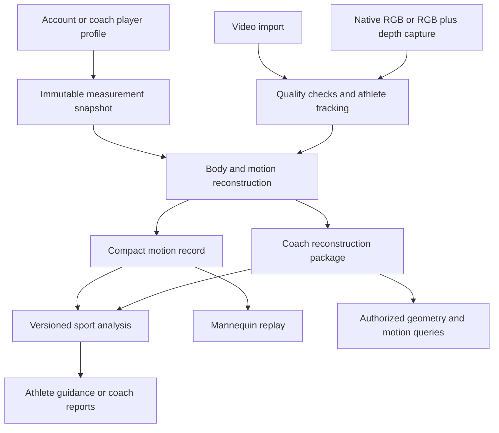

# KinetiQ: 3D skinned body and motion implementation plan

### 2026-10-17 visual replay update

The active viewer now uses a procedural neutral artist mannequin with distinct chest/waist/pelvis, tapered limbs, hands and feet for both original and saved-rig timelines. Stable display lengths, bounded spike filtering, adaptive temporal smoothing and frame interpolation improve motion continuity without rewriting stored landmarks or metrics. Gaps and unsupported joints stay hidden. See `skinner_implementation_checklist.md` for evidence and remaining device/recording checks.

## Latest execution checkpoint: 2026-10-16, ball and reviewed shots

This supersedes earlier notes that the development database is stopped or no ball detector is implemented.

- [x] Development PostgreSQL started and migrated through 0010.
- [x] Experimental pinned YOLOX Nano adapter, bounded pre-deletion ball pass, numerical track storage and conservative release candidates implemented.
- [x] Owner-reviewed shot intervals, missed-shot entry, immutable prediction provenance, scoped export/deletion, per-shot replay and movement consistency implemented.
- [x] Supported body measurements near uncertain release windows and per-metric comparison implemented.
- [x] Evaluation manifest/CLI and annotation protocol written; no benchmark claimed.
- [ ] Final integrated regression tests, representative labeled footage, and physical-device validation.
- [ ] Validated automatic full-shot segmentation, calibrated ball speed/arc, observable spin and validated coach recommendations.

TypeScript and Python compiler checks passed during integration; they do not establish runtime correctness or measurement accuracy. See [runtime details](docs/design/basketball-runtime-v1.md) and [resumable checklist](basketball_implementation_checklist.md). Prior completed tests below describe earlier code revisions.

Created: 2026-10-02. Status: implementation specification with an experimental software slice recorded below; unverified requirements remain open.

The requested filename uses “skinner.” In the implementation, use the standard terms **skinned body model**, **skeleton**, **mesh**, and **motion session**. Skinning attaches the visible mannequin surface to its skeleton. It does not mean retaining a photograph of the person's skin.

Quick navigation: [repository starting point](#2-current-repository-verified-starting-point), [profiles and roster](#4-accounts-players-roster-and-authority), [body measurements](#5-body-measurements-and-their-actual-use), [capture](#6-capture-and-import-contract), [reconstruction](#7-reconstruction-providers-and-fitting), [athlete/coach split](#8-athlete-and-coach-processingstorage-profiles), [data contracts](#9-canonical-motion-and-artifact-contracts), [coach queries](#10-querying-the-coachs-skinned-model), [migration](#12-database-migrations-and-historical-integrity), [implementation milestones](#17-implementation-milestones-and-exit-criteria), [resume checklist](#22-resume-checklist-and-progress-log).

## 1. Purpose and accepted product requirements

Build a neutral, untextured animated person from an athlete's recorded movement. Use the reconstructed motion for measurements, replay, comparisons, and coaching. Preserve the athlete/coach split already started in the frontend.

The user has explicitly requested:

- A neutral untextured mannequin, with relevant individual body proportions.
- Capture checks, including whether the athlete is fully visible.
- Height, wingspan, and other useful measurements collected during athlete onboarding and when a coach creates a player.
- A coach roster: create players, select a player, and retrieve that player's profiles, sessions, and results later.
- An efficient athlete pipeline that stores numerical movement information.
- A heavier coach pipeline retaining a queryable fitted body model and enough numerical data for deeper analysis.
- A durable implementation guide in this root document before code changes begin.

The prior agreed direction also includes ordinary video uploads, an Apple depth capture mode, uncertainty-aware metrics, and deleting temporary source media after processing. Both roles should have replay. Athlete storage therefore includes compact motion tracks as well as summary numbers; summaries alone cannot recreate an animation.

### 1.1 Product decisions to carry forward

1. Start with one athlete and one basketball shooting movement per short clip.
2. Treat capture capability, processing tier, account role, and resource access as separate concepts.
3. Use one versioned numerical motion contract across estimators and sports.
4. Compute reports and replay from the same identified reconstruction revision.
5. Retain rich derived geometry for coach sessions; a heavier pipeline does not automatically authorize permanent source-video retention.
6. Store historical measurements and reconstruction versions. Updating a player's height must not silently rewrite previous sessions.
7. Select model providers after a measured prototype comparison. Apple Vision, MediaPipe, and SAM 3D Body are candidates, not proven accuracy winners for basketball.
8. Build a usable replay and supported metrics before photorealism, detailed fingers, multiple simultaneous athletes, or custom hardware.

### 1.2 Proposed defaults versus settled requirements

This document makes implementation proposals where the user has not specified details: a personal coach workspace, optional measurement entry with completeness indicators, structured model queries, private artifact storage, asynchronous workers, and configurable source retention. These are defaults for implementation planning, not claims of additional user-approved purchases or deployments.

Do not block initial schema, roster, or replay work on optional decisions listed in section 20. Resolve model licenses, retention promises, resource costs, and validation thresholds before releasing dependent functionality.

## 2. Current repository: verified starting point

Re-read these files when implementation resumes; the repository may have changed since this inspection.

| Existing path | Current behavior | Required evolution |
| --- | --- | --- |
| `frontend/package.json` | Expo 54, React Native 0.81, Expo Router; image-picker dependency is on a different major SDK line | Check SDK-compatible dependencies before native work; use development builds |
| `frontend/app/(tabs)/upload.tsx` | ImagePicker record/import; call `/analyze`, then post returned result to `/me/sessions` | Dedicated capture flow, checks, player selection, processing status, canonical session creation |
| `frontend/services/kinetiq-api.ts` | Multipart video upload to `/analyze`, without the authenticated API helper | Authenticated session/job client and typed upload completion |
| `frontend/context/auth-context.tsx` | Role stored locally with AsyncStorage | Server-backed role/capabilities; local state is a UI cache |
| `frontend/app/onboarding/username.tsx` | Username setup, then role-specific navigation | Resumable profile/measurement onboarding after account identity is established |
| `frontend/app/coach/athletes.tsx` | Roster placeholder | Persistent create/list/search/detail/archive player flow |
| `frontend/app/coach/sessions.tsx` | Coach starter screen | Sessions scoped to authorized roster players |
| `frontend/hooks/use-user-profile.ts` | `/me` mapped into a limited frontend profile | Typed role, subject profile, measurement completeness, onboarding state |
| `frontend/types/analysis.ts` | Legacy result types require numeric values and scores | Versioned result union, nullable measurements, quality, motion/artifact references |
| `frontend/app/shot-breakdown.tsx`, `phase-detail.tsx` | Legacy score, GIF, and phase-image display | Version-aware mannequin replay and supported metrics |
| `backend/api.py` | Public `/analyze`, entire upload read into memory, synchronous request lifecycle with threadpool work | Authenticated bounded input, private uploads, durable jobs |
| `backend/analyzer/pose.py` | MediaPipe Heavy; normalized `pose_landmarks`, nominal frame-index timestamps, full RGB frames in memory | Provider adapters, true presentation timestamps, explicit coordinate and quality metadata |
| `backend/analyzer/geometry.py` | Angle calculation adds epsilon; invalid geometry does not have an explicit unavailable state | Finite/degenerate checks, explicit angle conventions, validity propagation |
| `backend/analyzer/sports/basketball/metrics.py` | Uses normalized coordinates' first three values; ignores saved visibility | Measurements from consistent 3D coordinates with quality gates |
| `backend/analyzer/sports/basketball/phases.py` | Image-height heuristics and frame-gap elbow change infer phases/release | Timestamp-based phase detection with declared evidence and uncertainty |
| `backend/analyzer/pipeline.py` | Metrics → phases → scores → rendering | Separate reconstruction, analysis, and presentation jobs |
| `backend/analyzer/sports/base.py` | Stateless sport plugins | Preserve statelessness; introduce a v2 motion interface without breaking tennis |
| `backend/analyzer/skeleton.py` | Draws on original RGB frames and embeds those frames in GIF/JPEG output | New sessions render only the mannequin; legacy images remain legacy personal media |
| `backend/db/models.py` | Users, user sports, analysis sessions owned by login user; JSONB results | Separate subject identity, ownership/access, versions, jobs, and artifacts |
| `backend/routers/sessions.py` | Client posts analysis JSON; server stores extracted score | Server-created canonical results, access checks, artifact references |
| `backend/auth/dependency.py` | Auth0-backed user resolution | Reuse identity; add subject/workspace/session authorization |
| `backend/alembic/versions/0001_initial.py` | Initial persisted schema | Additive migrations and explicit legacy backfill |
| `backend/render.yaml` | One free web service | Independent CPU/GPU worker deployment and private storage when authorized |

Important existing privacy detail: deleting the original MP4 in `/analyze` currently does not remove the source-derived GIF and phase photographs stored in the analysis JSON. The new mode must stop creating those artifacts. Do not claim existing sessions are mannequin-only.

At this inspection the worktree has prior role/UI edits, documentation removals, folder readmes, and untracked ` 2.tsx` duplicates. Preserve unrelated work. Do not delete duplicates, restore removed `docs/superpowers`, or perform a general repository cleanup as part of this feature.

## 3. System architecture



### 3.1 Responsibility boundaries

- **Native capture module:** camera ownership, video/depth synchronization, calibration, orientation, capture diagnostics, optional Apple Vision inference, safe temporary files.
- **React Native application:** onboarding, roster, capture UI, upload/resume, job status, replay controls, role-specific result presentation.
- **API:** identity, access rules, input validation, session metadata, job scheduling, artifact access, query contracts.
- **Reconstruction workers:** decode, track, estimate, fit, assess quality, publish immutable motion/model artifacts.
- **Analysis workers:** deterministic metrics, phase detection, comparison, approved coaching facts.
- **Database:** relationships, snapshots, job states, summaries, revision manifests; keep large arrays out of general JSONB responses.
- **Private object storage:** numerical tracks, model parameters, optional authorized derived observations, temporary source media.
- **Renderer:** display a selected revision without altering its measurement data.

API containers must remain usable without loading GPU libraries. Apple Vision/AVFoundation execute on supported Apple platforms; do not import them into the Linux FastAPI worker. A server estimator needing RGB must temporarily receive RGB; compact Apple joint outputs cannot substitute for imagery required by that estimator.

## 4. Accounts, players, roster, and authority

### 4.1 Separate login identity from the person being analyzed

An Auth0 user is an account. An `AthleteProfile` is a subject whose body and movements are being analyzed. A coach must be able to create an athlete profile without creating an Auth0 account for that person.

Proposed entities:

| Entity | Essential fields / rules |
| --- | --- |
| `User` additions | `primary_role`, onboarding state/version; role set through authenticated server API |
| `Workspace` | ID, owner user, name, state; v1 creates a private coach workspace |
| `WorkspaceMembership` | workspace, user, role, status; v1 owner role, explicit future staff roles |
| `AthleteProfile` | ID, display name, nullable linked account, creator, nullable managing workspace, status, timestamps |
| `RosterMembership` | workspace, athlete, status, created/archived times; unique active membership |
| `AthleteMeasurementVersion` | athlete, effective time, recorded time, actor, structured fields, provenance, version |
| `PlayerLinkInvitation` | token hash, target profile/account intent, issuer, expiry, accepted/revoked state |
| `SessionAccessGrant` | subject session or explicit collection scope, grantee, permissions, revoked time |

Use foreign keys, unique constraints, and transactions to prevent duplicate roster membership and conflicting claims. A linked account should have a single canonical self athlete profile. A managed profile can remain unclaimed indefinitely.

### 4.2 Athlete onboarding

Flow: authenticate → persist role → username → body measurements → sport/handedness → app. Make progress resumable and skip already completed steps on later logins.

Provide metric and imperial input, short measurement instructions, and “I don't know / add later.” Missing dimensions reduce specific capabilities; they do not become zero. A coach account does not need personal body measurements unless that coach also has a self athlete profile.

### 4.3 Coach workflow

1. Open Athletes and choose Add player.
2. Enter display name, sport, shooting hand, and known body measurements.
3. Save a managed player immediately, without sending messages or invitations automatically.
4. Show the player detail page: measurements, session history, progress, notes, capture action.
5. Start recording/import from that player page; persist subject ID before upload begins.
6. Display the selected player's name on capture and submission screens to prevent attribution mistakes.
7. Reopen the player later to query any authorized completed reconstruction.
8. Archive a roster entry without silently deleting the subject or their history.

If inviting/linking a real account is added, use an explicit invitation and recipient acceptance. Never link by matching display names or email alone. Claiming a managed profile with an existing self profile requires an explicit merge workflow with previews of sessions and access changes; never overwrite either history. Preserve subject aliases and audit the merge.

### 4.4 Authorization policy

- Self athletes access their own profile and self-owned sessions.
- Coaches access profiles/sessions explicitly managed by or shared with their workspace.
- A roster relationship does not automatically reveal a linked athlete's entire personal history.
- Track session `subject_athlete_id`, `created_by_user_id`, `owner_user_id` or `owner_workspace_id`, and explicit sharing separately. Require exactly one owner.
- Authorize profile reads, measurement writes, capture/job creation, every query, artifact download, annotations, exports, and deletion.
- Validate subject and workspace relationships server-side. Client role, selected IDs, and URL possession are insufficient authorization.
- Archived/revoked relationships deny new coach jobs and queries; session ownership and subject deletion requests follow a documented policy.
- Use short-lived artifact access. Where immediate revocation is required, use an authenticated download proxy; signed URLs can remain usable until expiry. State this limit clearly.
- Keep cache keys scoped to account/workspace/subject/revision and clear protected caches on sign-out or access changes.
- Record administrative changes and data access metadata without logging body arrays, tokens, private URLs, or video.

Before public use with minors, resolve guardian authority, account linking, and deletion responsibilities. Do not implement age inference from imagery or request unrelated sensitive attributes to fit a mannequin.

## 5. Body measurements and their actual use

### 5.1 Fields

| Field | Collection | Use / limitation |
| --- | --- | --- |
| Height | Prompt during onboarding/player creation; barefoot upright instructions | Scale prior and proportional comparisons; self-report is not calibrated camera depth |
| Wingspan | Prompt alongside height; fingertip-to-fingertip with arms extended horizontally | Constrain combined shoulder/arm/hand dimensions, not each segment independently |
| Shooting/dominant hand | Left, right, both, unknown; session override | Choose relevant side without relying on one noisy wrist detection |
| Standing reach | Optional later with a defined measurement protocol | Context for reach/release-height analysis when scale is adequate |
| Segment lengths | Advanced optional entry by a trained coach | Useful only with clear anatomical endpoints and source reliability |
| Weight | Defer unless a validated analysis needs it | Not required for angle measurement or replay; do not imply joint forces from video |
| Age-related information | Only when needed for account/consent or validated comparisons | Do not infer developmental norms or collect exact birth date solely for reconstruction |

Store lengths in meters; display chosen units. Each supplied measurement needs `value`, `unit`, `source` (`self_reported`, `coach_measured`, `sensor_estimated`), `measured_at`, `recorded_by`, and optional uncertainty/method. Separate reported values from model-fitted estimates.

Validate finite positive inputs and unit conversions. Use broad configurable plausibility warnings with confirmation; avoid silently excluding unusual proportions or youth athletes. Permit unknown values. Warn about inconsistent height/wingspan, but do not force a population-average ratio.

### 5.2 Fitting rules

- Treat reported dimensions as soft constraints with source-dependent weights.
- Height does not resolve hidden limbs or recover camera calibration.
- Wingspan includes shoulders, both arms, and hands. Map it to defined template landmarks; a wrist-only skeleton cannot directly verify fingertip span.
- Do not derive both arm lengths from one wingspan number without retaining that assumption and uncertainty.
- Keep shape stable within a session. Longitudinal shape can change with growth or updated measurements.
- Snapshot the measurement revision when the session is finalized for processing. Allow a deliberate pre-processing correction; freeze the chosen snapshot with each reconstruction revision.
- Create an explicit empty/unknown measurement snapshot when no dimensions were supplied, so every session has reproducible profile inputs.
- If a later correction triggers a refit, create a new revision and disclose its inputs. Old scores remain attached to old inputs.
- Normalize distances by relevant body dimensions only when those dimensions are usable. Uniform scale changes do not correct angular ambiguity.
- Height/wingspan can inform comparisons and fitting. They do not justify invented ideal elbow angles or unvalidated body-type-specific advice.

## 6. Capture and import contract

### 6.1 Capture modes

| Mode | Preserved evidence | Planned behavior |
| --- | --- | --- |
| `uploaded_rgb` | Video presentation timestamps, frames, orientation, available metadata | No claim of measured sensor depth |
| `native_rgb` | App-recorded frames/timestamps and supported calibration | Guided capture on compatible devices without usable depth |
| `native_rgbd` | Synchronized RGB, depth, calibration, timestamps, dropped-data flags | Preferred Apple depth experiment |
| `dual_view_rgbd` | Two calibrated, synchronized streams | Later coach milestone; not a v1 prerequisite |

Start with an explicit short-clip limit (proposed 15 seconds, matching current capture UI), one selected athlete, and one shot. Enforce limits on the server as well as in the UI. Configure byte, duration, resolution, decoded-frame, and concurrent-job limits after profiling. Reject misleading extensions and malformed/unsupported media using actual decoding metadata.

Imported footage needs post-import quality review; it cannot have live pre-recording checks. Preserve actual presentation timestamps for variable-frame-rate and slow-motion files. Decide whether analysis refers to capture time or exported playback time; if true capture timing cannot be established, mark velocities/timing accordingly instead of inventing frame spacing.

### 6.2 Swift module responsibilities

Create a local Expo module, proposed `frontend/modules/kinetiq-motion`, with these typed operations:

- `getCapabilities()` → supported RGB/depth formats, relevant Vision support, runtime limitations.
- `startPreview(config)` / `stopPreview()` → one owned capture session and lightweight diagnostics.
- `startCapture(config)` / `stopCapture()` → private local capture package manifest.
- `cancelCapture()` → stop hardware and schedule cleanup.
- `inspectImportedVideo(uri)` → metadata, timing semantics, quality summary.
- Optional `extractPose(packageId, config)` → derived tracks with provider/version metadata.

Use AVFoundation video/depth outputs and their synchronizer. Query supported format combinations; never assume RGB and depth both run at 60/120 FPS. Maintain RGB-only measurements when a depth frame is missing. Preserve the stream timestamps rather than duplicating the latest depth as a new observation. Apple's APIs expose these capture components in its [LiDAR sample](https://developer.apple.com/documentation/AVFoundation/capturing-depth-using-the-lidar-camera).

Preserve intrinsics, reference dimensions, depth/disparity conversion, orientation, lens/crop transforms, calibration validity, and which processing/filters were applied. Correct mirroring only for presentation; anatomical left/right must remain stable. Check capture interruptions, app backgrounding, thermal state, storage pressure, permissions, and camera switching.

Do not stream full RGB/depth arrays through the JavaScript bridge per frame. Keep heavy processing native, send small diagnostics events, and transfer completed files via manifests. Disable audio by default because this feature does not need it. Handle any audio present in imports as temporary media.

ARKit live body tracking is a separate experimental adapter. Do not assume an ARKit body-tracking configuration exposes all world-tracking depth features, or that ARKit and independent AVFoundation sessions can own the same camera concurrently.

Use an Expo development build for custom Swift code; keep the current React Native UI. Native module configuration belongs in reproducible module/config-plugin files. [Expo documentation](https://docs.expo.dev/workflow/customizing/)

### 6.3 Capture quality checks

Each check returns `{code, severity, affected_joints, interval, message, evidence}`. Severity is `info`, `warning`, or `blocking`. Thresholds live in versioned configuration and must be tuned with recorded examples; they are not universal scientific cutoffs.

| Check | Evidence and response |
| --- | --- |
| Full-body framing | Person bounds plus observed head, feet, and relevant limbs; require room for hands above the head during a shot |
| Person size | Pixel coverage/height; warn if too small for selected metrics |
| Athlete identity | Selected track continuity; stop/review when identity switches |
| Lighting/blur | Image diagnostics and model failure evidence; advise better light/steadier capture |
| Joint visibility | Distinguish visible evidence from a model's inferred complete skeleton |
| Occlusion | Shooting arm/hand behind torso, ball, or another person; gate affected metrics |
| Camera motion | Motion estimate or scene stability; warn when reference-frame reconstruction is unreliable |
| Depth support | Hardware/format check; offer RGB fallback honestly |
| Depth quality | Valid samples/coverage, temporal mismatch, surface consistency; never fabricate an AVDepthData confidence map |
| Clip completeness | Stance, loading, extension, and follow-through evidence; allow partial report when meaningful |
| Time quality | Missing/dropped/ambiguous timestamps; suppress derivative metrics as needed |

Use persistence/hysteresis to avoid flashing guidance. A full list of predicted joints does not prove the body is visible. Hard blocks should be limited to unusable inputs; a hidden guide hand need not invalidate a clearly visible knee metric. UI messages should explain actionable capture problems in plain language.

## 7. Reconstruction providers and fitting

### 7.1 Shared provider interface

Define capability-based adapters that report supported joints, coordinate frames, scale provenance, depth acceptance, execution environment, estimator version/checksum, and available quality signals. Adapters output observations; they must not invent missing joints as reliable detections.

Initial candidates:

1. **Corrected MediaPipe baseline:** retain image landmarks for reprojection and properly declared world landmarks for 3D comparisons; model-estimated world scale is not equivalent to sensor-measured scale.
2. **Apple Vision RGB/RGB-D:** compare identical RGB input with and without corresponding depth where possible. Its documented skeleton has 17 joints and its basic request selects the most prominent person. Selection/cropping must preserve calibration mappings. [Vision documentation](https://developer.apple.com/documentation/vision/identifying-3d-human-body-poses-in-images)
3. **SAM 3D Body + MHR coach experiment:** SAM estimates pose/mesh from images, while MHR represents an articulated body. Add temporal identity/shape consistency and custom fitting. Neither is an already validated KinetiQ basketball pipeline. [SAM 3D Body](https://github.com/facebookresearch/sam-3d-body), [MHR](https://github.com/facebookresearch/MHR)

Pin code, weights, template assets, dependencies, and licenses. MHR and SAM have different licenses; transitive detectors, weights, and body templates need their own review. Do not assume a public research repository permits unrestricted commercial deployment.

### 7.2 Processing stages

1. Validate capture manifest, decode with timestamps, and select/track subject.
2. Preserve image-coordinate observations and preprocessing transforms.
3. Produce initial pose and, for the rich tier, body-shape estimates.
4. Associate measured depth with visible person pixels using calibration; reject outliers and edges contaminated by background.
5. Fit one shape and per-time pose/root transform across a sequence or overlapping windows.
6. Compute fit diagnostics and observable support per joint/time interval.
7. Save observations and fitted outputs according to the session's declared retention profile.
8. Run sport metrics on the approved numerical revision.
9. Build replay artifacts and atomically publish their manifest.

For a proposed richer fitter, minimize a weighted combination of image-keypoint reprojection error, silhouette disagreement, valid visible-surface depth disagreement, measurement-prior disagreement, temporal discontinuity, and broad anatomical constraints. Each term is optional according to available evidence. Record weights/configuration with the revision.

Do not present surface depth as a directly measured joint center. Keep clothing, occlusion, and depth uncertainty in the model. Do not enforce both feet on the floor during a jump, exact symmetry, or ideal shooting technique. Shape priors should stabilize uncertain estimates without concealing the uncertainty.

Use overlapping fitting windows to bound memory and avoid visible seams. Validate rapid release motion before adopting smoothing. Preserve unfiltered observations when retained, plus the final fitted track; replay interpolation never becomes an extra captured sample.

### 7.3 Coordinate specification

Freeze this convention before implementing geometry:

- Canonical coordinates are right-handed; lengths use meters, timestamps use seconds from capture start, quaternions use `[x, y, z, w]`.
- In the canonical camera frame: X is image-right, Y is up, Z points toward the camera. Explicitly convert from each provider's convention.
- Store body-root-relative joint positions and a separate root transform. Do not label root-relative points world positions.
- A world frame is optional: establish gravity/up and origin only with evidence. If unavailable, mark root motion camera-relative and suppress unsupported world displacement.
- Joint names describe the athlete's anatomical left/right. Viewer mirroring never swaps the data labels.
- Store transforms with named source/destination frames and calibration provenance. Canonical transport matrices are row-major arrays applied to homogeneous column vectors: `p_destination = T_destination_from_source * p_source`. Convert explicitly to a renderer/provider's matrix layout; never rely on implicit transposition.
- Keep image UV coordinates, model-local coordinates, camera coordinates, and world coordinates in separate typed fields.
- Declare each joint's anatomical/model definition and provider mapping. Include unsupported mappings as absent, not fake zero points.
- Validate rotation normalization, transform composition, units, handedness, and known camera projections with synthetic fixtures before real clips.

Rig pose parameters may not map directly to anatomical flexion. Preserve native parameters for reproducibility and derive named sport metrics through an explicit convention.

## 8. Athlete and coach processing/storage profiles

Use a server-approved `processing_profile`, selected at session creation. A UI role change alone cannot upgrade existing data.

| Capability | `athlete_compact_v1` | `coach_reconstruction_v1` |
| --- | --- | --- |
| Quality/validity rules | Full required checks | Same rules, with richer diagnostics |
| Numerical tracks | Timestamped canonical joints, root transform, quality, fitted proportions, supported rotations | Same plus native body parameters and retained fit inputs |
| Replay | Neutral mannequin from compact motion and pinned rig | Neutral mannequin from fitted body and pinned rig |
| Summary metrics | Persisted versioned metrics/phases | Same plus queryable intervals and comparisons |
| Body reconstruction | Lightweight consistent shape/rig fit | Sequence fitting of full parametric model, initially GPU worker candidate |
| Durable geometry | Shared template/rig reference and per-session fitted shape | Exact template/version, shape parameters, pose/scaling/corrective parameters needed to recreate fitted mesh |
| Derived observations | Minimum needed for supported metrics; capabilities explicit | Numerical keypoints, visibility, calibration, residuals; optional person-only depth samples if specifically included in the retention policy |
| Source RGB/audio | Temporary processing only | Temporary processing only by default |
| Refit capability | Limited by retained inputs | Refit against retained observations where sufficient; cannot recover deleted image detail |

Coach retention must support reconstructing the actual chosen model, including any corrective deformation parameters required by that model. A generic low-detail export may be a display artifact; it is not automatically an exact replacement for the fitting model.

Masks and depth/point samples can themselves reveal body shape. Retain only explicitly needed derived inputs, isolate the chosen person, and document their retention separately. Default durable coach package: model parameters, numerical keypoints, calibration, quality/residuals, and measurement snapshot. Person-only depth support is an additional declared capability when retained. Do not promise future silhouette/image-based refits if masks/images were deleted.

### 8.1 Upgrade and downgrade behavior

- Before source expiry: an authorized upgrade may create a coach reconstruction revision using still-available input, within the disclosed retention policy.
- After source deletion: recompute only from available numerical/model inputs. Return `source_required` for a request requiring deleted RGB/depth.
- Opening an athlete session in the coach view exposes its existing capabilities. It does not synthesize missing model evidence.
- A downgrade removes rich artifacts only through explicit retention/deletion policy and updates capabilities; compact playback can remain if its inputs remain.
- Heavier computation does not guarantee higher accuracy. Publish provider/profile validation results and expose partial/unsupported outputs honestly.

## 9. Canonical motion and artifact contracts

Use versioned Pydantic contracts on the backend and generated or equivalently validated TypeScript/native contracts. Distinguish transport validation from scientific validity. A syntactically valid client motion array is still client-supplied evidence.

Illustrative metadata shape (IDs are placeholders; large arrays live in referenced artifacts):

```json
{
  "schema_version": "motion_session.v1",
  "session_id": "session-uuid",
  "subject_athlete_id": "athlete-uuid",
  "processing_profile": "coach_reconstruction_v1",
  "sport": "basketball",
  "motion": "jump_shot",
  "capture_mode": "native_rgbd",
  "measurement_version_id": "measurement-uuid",
  "reconstruction_revision_id": "revision-uuid",
  "coordinate_convention": "kinetiq_rh_yup_v1",
  "scale_source": "depth_assisted",
  "time_basis": "capture_presentation_time",
  "world_frame_available": false,
  "skeleton_definition_id": "skeleton-version",
  "body_model": {"family": "selected-provider", "asset_id": "pinned-asset"},
  "quality_status": "partial",
  "capabilities": {
    "joint_angles": true,
    "mesh_reconstruction": true,
    "wrist_flexion": false,
    "world_displacement": false,
    "refit_from_rgb": false
  },
  "artifacts": [
    {"id": "track-uuid", "kind": "canonical_motion", "format_version": "motion_arrays.v1"},
    {"id": "model-uuid", "kind": "body_parameters", "format_version": "provider-specific-v1"}
  ]
}
```

Define `scale_source` values including `unknown`, `reference_body`, `reported_measurement`, `depth_assisted`, and `calibrated_multiview`; store detail/uncertainty separately. None of these alone guarantees every joint is accurate.

### 9.1 Required arrays and metadata

- Sample timestamps and original frame/sample IDs; monotonic and explicitly mapped across streams.
- Ordered joint definitions, parent indices, optional rest/bind pose.
- Positions `[T,J,3]`; optional rotations `[T,J,4]` plus rotation-validity flags.
- Root transforms `[T,4,4]` or documented equivalent and frame reference.
- Joint availability/visibility/support arrays. Use an explicit validity mask for binary arrays; JSON missing values are `null`.
- Provider confidence where genuinely available; do not manufacture percentages for providers that expose only tracking flags.
- Reconstruction quality derived from observed support, reprojection/depth residuals, identity continuity, and temporal consistency.
- Body parameters, scale/shape revision, estimator/configuration/weights IDs, and preprocessing transforms.
- Metric/phase quality with reason codes and valid-sample coverage.
- Source/derived-input availability manifest including deletion/expiry status.

Choose a documented compressed binary container for arrays; for a Python-first prototype, NPZ without object arrays/pickle is acceptable. Mobile clients should receive a documented packed-array/JSON manifest contract rather than implementing arbitrary Python serialization. Never deserialize untrusted pickle or executable model files from clients.

Artifact manifests contain immutable IDs, format/schema version, checksum, size, content type, creator job, parent revision, privacy class, expiry, and model/license references. Keep persistent private object keys server-side; issue access after authorization. Chunk tracks by time for large sessions without losing sample IDs at boundaries.

## 10. Querying the coach's skinned model

“Query the model” means an authorized numerical/geometry operation on a selected saved revision. Initial implementation is a deterministic service; natural-language interpretation can be added above it later.

Supported query families, gated by retained capabilities:

- Named joint angle at a time, phase, or interval.
- Joint/segment trajectory and extrema over a specified interval.
- Timing between supported phase events.
- Distance normalized by height, wingspan, or another available measurement.
- Reconstructed surface landmark position using a model-version-specific definition.
- Comparison of two authorized sessions with compatible metric definitions.
- Recompute a metric with a new metric version from retained motion.
- Refit a new reconstruction revision against available retained observations.

Surface distances refer to the reconstructed template and fit. They are not exact anatomical measurements, muscle forces, or clothing scans. Unsupported axial rotations, hand detail, body circumference, release events, and world trajectories must return an explicit reason.

Example request:

```json
{
  "reconstruction_revision_id": "revision-uuid",
  "operation": "joint_angle_series",
  "joint": "right_elbow",
  "convention": "interior_angle_deg",
  "interval_seconds": [0.8, 1.4],
  "aggregation": ["min", "max"],
  "quality_policy": "supported_samples_only_v1"
}
```

Response must identify session/revision, metric version, units/convention, sample timestamps, values/nulls, coverage, excluded intervals and reasons, and source capabilities. Aggregations use valid samples and disclose denominators; do not hide gaps through interpolation. Return `unsupported` or `insufficient_evidence` instead of a fabricated value. An invalid request is a validation error, distinct from a valid query with insufficient evidence.

Use an allowlist of operations, joints, intervals, and output sizes. Authorize every session in comparisons. Cache by session + revision + normalized query + measurement snapshot + metric version; re-check authorization on cache reads. Expensive refits are jobs with limits and new revisions, not arbitrary code executed by the API.

If an LLM interface is later added, it may translate a coach request into these typed operations and explain results. It must not invent new numbers, execute user SQL/Python, or treat annotations as instructions to access other players. Every numerical claim must reference a returned result/revision and retain its limitations.

## 11. Metrics, basketball phases, and coaching

### 11.1 Measurement contract

Every metric must include:

```text
metric_id / metric_version
value or null, unit, angle_convention where relevant
time or interval, reconstruction_revision_id
measurement_version_id and reference_frame
quality_state, coverage, reason_codes
evidence/provenance and optional validated uncertainty interval
```

Do not use `0`, `90`, or a missing-key default to represent failed tracking. A straight elbow is 180 degrees under the interior-angle convention and approximately 0 degrees under a flexion-from-straight convention; the number alone does not indicate validity.

For a three-point angle, validate finite positions, valid supporting joints, and nondegenerate segment lengths before computing the clipped dot-product angle. Store convention and anatomical definitions. Map animation rig rotations to anatomical angles explicitly; rig Euler angles cannot be displayed as clinical or sport flexion by renaming the fields.

Use true sample times for velocity/acceleration. Do not differentiate across long gaps or present interpolated display frames as observations. Angular velocity in degrees/second must not inherit the legacy “angle change per frame index” convention.

### 11.2 Initial basketball scope

| Metric or event | Initial plan | Evidence needed |
| --- | --- | --- |
| Elbow interior angle/extension curve | First supported metric candidate | Reliable shoulder, elbow, wrist in consistent 3D coordinates |
| Knee angle/extension curve | First supported metric candidate | Reliable hip, knee, ankle |
| Torso lean | Candidate after reference-frame validation | Defined torso axis and dependable vertical reference |
| Movement sequencing | Candidate after timestamp validation | Supported phase/events, timing uncertainty |
| Repeat consistency | Candidate within compatible versions | Same definitions, enough valid repetitions, coverage |
| Release frame | Mark body-only result as estimated release proxy | Confirmed release requires ball/hand separation evidence |
| Wrist flexion/forearm rotation | Defer until independently supported | Hand/segment orientation, suitable resolution and visibility |
| Jump/release height | Defer until scale/world support is validated | Ground reference, scale, tracked relevant landmark/ball |
| Ball trajectory/make-miss | Separate later pipeline | Ball/hoop observations; cannot recover from body-only records |

Maintain the existing basketball phase labels where useful for UI compatibility, but version new detection logic. Multiple shots in one clip should initially trigger a selection/trim flow or a clear unsupported result; do not select one silently. Missing start/end phases produce a partial result.

### 11.3 Scoring and explanations

- First expose descriptive measurements and comparison to the athlete's own consistent sessions.
- Do not transplant legacy hardcoded “ideal” thresholds onto newly defined 3D metrics without validation.
- Keep measurement accuracy, metric availability, and coaching validity as separate evaluations.
- Missing metrics do not become a poor-form score. Scores are nullable when evidence is inadequate.
- Use a versioned rule set for any score; record the reference population/protocol where relevant.
- Profile measurements may normalize distances and contextualize coaching. They must not create unsupported height/wingspan-specific ideals.
- The AI coach receives structured supported facts, quality limitations, and an approved feedback vocabulary/resource set. It does not produce measurements from an image prompt alone.
- Coach annotations are attributable interpretations and do not overwrite machine measurements.
- Sessions analyzed with incompatible model/metric versions should not be silently aggregated into improvement claims or leaderboards.

## 12. Database, migrations, and historical integrity

### 12.1 Session, job, and artifact entities

Extend existing models or introduce adjacent v2 tables; keep identifiers stable for existing sessions. Suggested additional entities:

| Entity | Key fields / purpose |
| --- | --- |
| `AnalysisSession` v2 fields | schema version, subject, creator, exclusive user/workspace owner, sport/motion, capture mode, profile, measurement snapshot, overall state, capture time, server creation time |
| `CaptureUpload` | session, upload manifest, expected parts/checksums/limits, completion state, expiry, source deletion state |
| `ProcessingJob` | session, kind, requested revision, durable state, idempotency key, attempts, lease/heartbeat, config/version IDs, safe error code |
| `ReconstructionRevision` | session, parent revision, measurement snapshot, provider/model/config, quality/capabilities, published manifest, created time |
| `AnalysisRevision` | reconstruction revision, sport engine/metric versions, nullable summaries, metric artifacts |
| `SessionArtifact` | session/revision, kind, object key, checksum, size, format version, privacy class, expiry, deletion state |
| `CoachAnnotation` | author/workspace, session/revision, original timestamp/interval, text, visibility, edit history |
| `AccessAuditEvent` | actor, resource, action, time, outcome; no body arrays/media in event payload |
| `JobOutbox` or equivalent | transactional scheduling intent, delivery state, retries |

Index roster by workspace/status/name, sessions by subject/capture time/ID, jobs by state/lease expiry, artifacts by expiry/deletion state. Paginate histories with a stable `(captured_at, id)` or `(created_at, id)` cursor, not timestamp alone. Separate user-reported capture time from trusted server time.

Use immutable measurement/reconstruction/analysis versions and explicit active revision pointers. Foreign keys must prevent a session from referencing another athlete's measurement snapshot. Validate JSON contracts at write time and specify database constraints for ownership and statuses.

### 12.2 Safe migration sequence

1. Add role/onboarding fields and workspace/athlete/measurement tables in a new Alembic revision. Do not rewrite `0001_initial.py` for an existing database.
2. Create self athlete profiles for users with personal legacy sessions. Use idempotent mapping keyed by user ID; do not infer coach status from a local device cache that the server cannot see.
3. Add nullable subject/owner/schema fields to legacy sessions, then backfill ownership from their existing `user_id`.
4. Tag existing payloads `legacy_v1`, retain their result semantics, and mark no canonical 3D reconstruction available. Do not manufacture 3D tracks from summary scores or GIFs.
5. Review the existing `analysis_sessions.user_id` cascading delete foreign key before allowing coach-managed sessions. Do not let deleting a creator account accidentally delete workspace/subject history. Retain legacy ownership mapping while v2 uses its explicit owner and subject policy; make the old field nullable for new workspace sessions when appropriate.
6. Add jobs/revisions/artifacts/access tables, then enforce constraints after backfill validation.
7. Add server-authoritative role onboarding. Existing client role can be offered as an initial preference, but backend permissions derive from persisted relationships.
8. Serve a discriminated legacy/v2 response while clients transition. Existing GIF sessions remain viewable under existing access rules.
9. Stop accepting client-authored canonical scores for v2. Retire or restrict public `/analyze` and legacy create behavior before public release; do not leave an unrestricted expensive endpoint beside the new authenticated path.
10. Migrate aggregate/statistics code to exclude incomplete, invalid, incompatible, or untrusted results as appropriate.

Legacy media cleanup is a separate explicit migration/product operation. Do not erase historical GIFs during an unrelated schema migration. Label retention differences and support deletion/export across old and new formats.

## 13. API design and asynchronous processing

These are proposed v2 routes. Reuse existing authentication and adapt naming to repository conventions without losing their semantics.

| Endpoint | Responsibility |
| --- | --- |
| `PATCH /v2/me/profile` | Persist role/onboarding/profile; choosing coach grants only own-workspace creation |
| `GET /v2/me/athlete-profile` | Read the canonical self subject created during onboarding |
| `GET /v2/workspaces/{id}/athletes` | Paginated authorized roster |
| `POST /v2/workspaces/{id}/athletes` | Create managed athlete plus initial optional measurements atomically |
| `GET /v2/athletes/{id}` | Authorized subject details and effective measurements |
| `POST /v2/athletes/{id}/measurement-versions` | Append a measurement revision with provenance |
| `PATCH /v2/workspaces/{id}/athletes/{athlete_id}` | Edit roster metadata/archive status with authority checks |
| `GET /v2/athletes/{id}/sessions` | Authorized history, filtered by accessible sessions |
| `POST /v2/sessions` | Reserve session/subject/profile/measurement snapshot and upload intent |
| `POST /v2/sessions/{id}/uploads` | Issue bounded private upload destinations/parts |
| `POST /v2/sessions/{id}/complete-upload` | Verify object completeness/checksums; schedule processing once |
| `GET /v2/jobs/{id}` | Durable stage/status/progress and safe errors |
| `POST /v2/jobs/{id}/cancel` | Authorized cancellation; initiate cleanup |
| `GET /v2/sessions/{id}` | Summary, quality, revision IDs, available capabilities |
| `GET /v2/sessions/{id}/motion` | Authorized replay manifest for a selected revision |
| `POST /v2/sessions/{id}/model-queries` | Allowlisted numerical/geometry queries |
| `POST /v2/sessions/{id}/reprocess` | New revision from available evidence; validate requested capability |
| `POST /v2/sessions/{id}/annotations` | Coach notes referencing original time/revision |
| `GET /v2/artifacts/{id}/download` | Authorize and deliver/provide short-lived artifact access |
| `DELETE /v2/sessions/{id}` | Tombstone session and schedule deletion of all related copies |

GET endpoints should not create resources as a hidden side effect; create the self profile during onboarding or use an explicit POST if absent. Invitation/sharing/export endpoints require the authority and acceptance semantics in section 4; do not implement outbound messages implicitly.

### 13.1 Job lifecycle

```text
awaiting_upload → validating → queued → processing → publishing → completed
                               │            │          │
                               └────────────┴──────────┴→ failed
any nonterminal state → cancel_requested → cancelled
validation or processing → quality_rejected
unfinished upload / unusable expired source → expired
```

Within `processing`, report stages such as tracking, estimating, fitting, and analyzing. `quality_status` is separate from job state: a completed session may have partial metrics. `quality_rejected` means no useful supported result will be published. Errors must distinguish invalid media, no usable athlete, unsupported capability, worker failure, source expiry, and insufficient evidence.

- Commit session/job/outbox intent together, then enqueue. Recover from queue delivery failure by replaying the outbox.
- Workers claim jobs with leases/heartbeats. Retries are bounded and idempotent; abandoned leases are recoverable.
- Carry idempotency keys through upload completion, job creation, publication, and reprocessing. Repeated taps must not duplicate sessions or GPU bills.
- Uploads have ownership, deadlines, size/type constraints, and completion checks; a caller cannot point the worker at an arbitrary URL/path.
- Write artifacts to a staging prefix, verify checksums/schema, publish an immutable manifest transactionally, then update the active revision pointer.
- A retry cannot publish over a newer revision or resurrect a tombstoned session. Re-check deletion/access state before expensive stages and publication.
- Source cleanup must not race an active allowed job. Use leases within a hard disclosed retention deadline, cancellation at expiry, and cleanup retry state.
- Progress labels are more honest than fabricated precise completion percentages. Do not promise a processing duration until measured.
- On-device-derived tracks carry provider and trust metadata. Recompute official metrics server-side; do not treat client observations as independently verified ground truth for competitive rankings.
- Scope worker concurrency, GPU memory/time, API rate limits, and per-workspace quotas. Record resource usage without recording sensitive payloads in logs.

Initial queue/worker selection is a short infrastructure decision: use a durable job store plus a maintained queue/worker mechanism, with separate CPU and GPU worker pools if needed. The current web threadpool is not a durable processing queue. Record the selected implementation and failure-recovery behavior here before integrating it.

## 14. Neutral mannequin rendering and UX

### 14.1 Rendering contract

- Use a neutral matte material, simple lighting, and optional ground grid. Exclude original textures, faces, clothing photographs, background imagery, and audio.
- Preserve fitted proportions. If privacy settings later use a generic display shape, identify it as such and keep numerical measurements based on the correct underlying revision.
- Use a versioned template/rig and explicit bind-pose mapping. Preserve native pose parameters where needed for exact rich-model reconstruction.
- For the initial iOS viewer, evaluate RealityKit through a native view as the primary candidate. Validate asset/animation import and mobile performance in a spike before committing to a renderer.
- A standard skinned GLB/glTF export can serve other clients if supported by the selected renderer; it is a presentation/export format, not the authoritative numerical schema. Validate units, joint hierarchy, rest pose, interpolation, and model-specific corrective deformation support.
- If a simplified mannequin uses capsules or a generic skin driven by joints, label it as an illustrative replay. Missing axial rotations should use a documented display convention and never become measured rotations.
- Renderer updates must not change analysis values. Export time interpolation is for viewing only.
- Poorly supported intervals should fade affected segments or show a clear marker. Do not animate a confidently held pose across a long gap.

### 14.2 Common controls

Play/pause, scrub, slow playback, reset view, front/side/top view, skeleton toggle, selected-joint curve, shot phase markers, and quality markers. Keep original capture time visible when comparisons are aligned. Screen-reader users need textual phase/metric access independent of a 3D canvas; respect reduced-motion preferences.

The user's ability to rotate a reconstructed mannequin does not mean the original camera observed that angle. Explain inferred/unsupported regions when relevant instead of presenting the opposite side as verified evidence.

### 14.3 Athlete screens

- Resumable body-measurement onboarding and later profile edits.
- Record/import with clear checks and useful guidance.
- Processing state that survives leaving/reopening the app.
- Replay, a small set of reliable metrics, limited actionable feedback, and within-athlete history.
- Display “Not available” with a reason for unsupported measurements; never coerce null into zero/NaN/poor score.

### 14.4 Coach screens

- Roster list, search, add/edit/archive, and measurement completeness.
- Player detail: current profile, dated measurement history, sessions, notes, capture action.
- Session workbench: mannequin, synchronized curves, interval selection, metric/model-query panel, quality/evidence summary.
- Compare attempts at equivalent phases, with original timing retained.
- Show processing profile, reconstruction/metric versions, and capability limits in an expandable details area.
- Query/refit results create explicit revisions; annotations remain linked to their source revision.
- Require deliberate session sharing; changing role or claiming a player is not a blanket data-sharing action.

## 15. Retention, privacy, and deletion implementation

Default proposed policy: source RGB/audio/depth packages are temporary for the selected processing workflow. Delete them promptly after successful durable publication, with a configurable maximum lifetime for abandoned/failed work. A 24-hour ceiling can be an initial engineering configuration proposal, but must be reviewed against actual job runtimes and the user-facing promise before release. Expiry is not permission to extend retention indefinitely on retries.

Durable athlete data consists of compact motion, fitted proportions, quality, metrics, and necessary metadata. Durable coach data additionally includes the declared reconstruction/observation package. Neither profile silently retains raw RGB.

Implementation checklist:

- Private storage, authenticated API access, encryption in transit and at rest, bounded signed access or an authorization proxy.
- Separate temporary-source and durable-derived storage prefixes/buckets and lifecycle policies.
- Remove temporary RGB frames, thumbnails, segmented color cutouts, worker scratch files, audio, and derivative photo previews after processing.
- Generate any persistent preview exclusively from the neutral mannequin.
- Strip unnecessary media metadata and local device paths from durable responses.
- Track `source_expires_at`, `source_deleted_at`, and deletion errors separately from job completion.
- Cleanup runs after success, failure, cancellation, upload abandonment, process crashes, and maximum-age expiry. An independent sweeper backs up application cleanup.
- Propagate session/account deletion to artifacts, cached query results, annotations, worker outputs, and recoverable backups according to a documented schedule. Tombstones must prevent retry/restoration resurrection.
- Signed URLs and downloaded copies have revocation limits; document them. Revoke future access and clear app caches when access is lost.
- Never use motion/video for training by default. Any research retention is a separate explicit opt-in and retention profile.
- A model without a face is still personal data. Do not promise anonymity.
- Deleting a roster entry, unlinking an account, deleting a session, and deleting an account are different operations with explicit effects.

After source deletion, show exact remaining capabilities: metric recomputation from tracks, mesh regeneration from parameters, optional refitting from retained observations. Do not promise re-running image estimation or discovering previously untracked ball/finger details.

## 16. Suggested implementation layout

Paths below are proposals, not files already present. Adapt names to local conventions while maintaining boundaries. Add a short extensionless `<foldername>_readme` to newly introduced source folders, following the user's existing organization preference; exclude generated/vendor directories.

```text
backend/
  motion/
    contracts.py             # coordinate, motion, quality, artifact schemas
    coordinates.py           # explicit conversions and skeleton mappings
    measurements.py          # shape priors and immutable measurement snapshots
    quality.py               # quality checks and policy aggregation
    fitting.py               # temporal/body fitting orchestration
    queries.py               # allowlisted geometry and motion operations
    providers/
      base.py                # capability-based observation adapter
      mediapipe_provider.py  # corrected baseline
      apple_import.py        # validate Apple-derived data; no Linux Vision import
      sam3d_provider.py      # optional rich provider in worker environment
  services/
    authorization.py         # subject/workspace/session rules
    roster.py                # player management and linking semantics
    motion_sessions.py       # revisions, publication, retention coordination
    artifact_store.py        # private storage interface
  jobs/
    contracts.py             # durable task payloads
    worker.py                # selected queue integration
    reconstruct.py           # staged reconstruction job
    reanalyze.py              # numerical metric/refit jobs
    cleanup.py                # deletion and orphan sweep
  routers/
    athletes.py
    workspaces.py
    motion_sessions.py
    jobs.py
    model_queries.py
  db/models.py               # extend/split carefully as complexity warrants
  alembic/versions/          # additive revisions
  analyzer/sports/           # existing plugins with explicit v2 integration

frontend/
  modules/kinetiq-motion/
    ios/                     # capture, Vision, optional native replay view
    src/                     # typed native bridge
  types/
    motion.ts
    athlete.ts
  services/
    motion-api.ts
    athletes-api.ts
  components/motion/
    MotionViewer.tsx
    MotionTimeline.tsx
    CaptureQualityPanel.tsx
    MetricSeries.tsx
  components/athletes/
    MeasurementForm.tsx
    PlayerSummary.tsx
  app/onboarding/measurements.tsx
  app/coach/athletes/         # list/new/[athleteId] routes after route migration
  app/coach/sessions/        # list/[sessionId] workbench routes
  app/capture.tsx
  app/session/[sessionId].tsx
```

Avoid duplicate Expo Router route names when replacing `coach/athletes.tsx` and `coach/sessions.tsx` with directory indexes. Reuse existing UI primitives and theme. Keep legacy views through an adapter/route dispatch while v2 rolls out. Do not apply a visual redesign unrelated to these workflows.

## 17. Implementation milestones and exit criteria

Implement in bounded increments with a functioning vertical slice at each stage. Update the progress log in section 22 after every meaningful implementation session.

### M0 — Contracts, feasibility, and baseline

- [x] Re-read this plan and inspect the current worktree and implementation entry points (2026-10-05 documentation audit).
- [x] Define and verify the initial RGB numerical read contract `motion_session.v1`: hip-relative coordinates, seconds, nullable observations, provider/model provenance, measurement reference, and explicit capabilities (`backend/studio/motion_contract.py`; verified 2026-10-06).
- [ ] Freeze the complete capture, metric, rich-model artifact, and privacy-class contracts, including native depth and immutable reconstruction history.
- [ ] Correct/characterize baseline coordinate, timestamp, and invalid-angle behavior in isolation; keep legacy result versioning explicit.
- [ ] Run a small Apple RGB/RGB-D capture feasibility spike on available hardware and a rich-body-model feasibility/license spike before committing to a provider.
- [ ] Define a small representative basketball evaluation set with consent and reference strategy.
- [x] Select a prototype renderer and worker approach: neutral volumetric joint renderer and PostgreSQL-queued worker are implemented; see `frontend/features/studio/mannequin-scene.tsx`, `backend/studio/worker.py`, and `backend/studio/README.md`. This is not a fitted mesh, a production infrastructure decision, or a cost evaluation.
- [ ] Record final provider/license, hardware, deployment-cost, and evaluation-set decisions.

Exit: known supported hardware, sample manifest, reproducible baseline, candidate availability/license record, and no unsupported accuracy promise. Profile/roster work can proceed independently of unresolved optional model choice.

### M1 — Subject profiles, measurements, and coach roster

- [x] Add additive Studio schema migrations for profiles, measurement snapshots, teams, and related workflows (`backend/alembic/versions/0002_performance_studio.py`–`0008_practice_tracking.py`).
- [ ] Backfill and verify ownership for historical legacy sessions; legacy sessions are not automatically migrated.
- [x] Persist athlete/coach workspace role and separate server-provisioned admin capability (`backend/studio/models.py`, `backend/studio/router.py`, `backend/studio/README.md`).
- [x] Implement account-linked athlete profile, optional height/wingspan snapshots, and profile/onboarding screens (`backend/studio/router.py`, `frontend/features/studio/people.tsx`, `frontend/features/studio/account.tsx`).
- [x] Implement managed player profiles, team roster/invitations, measurement history, and accessible player/session history routes (`backend/studio/router.py`, `backend/studio/claim_routes.py`, `frontend/features/studio/people.tsx`).
- [ ] Complete archive/edit workflows and end-to-end resume/reopen verification.
- [ ] Validate every subject/workspace authorization boundary and account-scoped cache behavior in deployed flows.

Exit: coach creates a player without a login account, records height/wingspan, leaves/reopens app, and retrieves the same player; unrelated users cannot access it. Existing athlete accounts remain usable.

### M2 — Compact motion vertical slice

- [x] Implement the prototype authenticated session/job lifecycle and bounded upload handling (`backend/studio/router.py`, `backend/studio/worker.py`, `backend/studio/README.md`). This is not yet the canonical versioned artifact contract.
- [ ] Finalize and verify the shared v2 motion, quality, timestamp, and artifact contract (pending implementation/review; do not infer completion from the experimental worker).
- [x] Adapt the current MediaPipe `studio-motion-1` record into validated canonical output without altering historical data; preserve available frame indices and reject unsupported or invalid contracts (`backend/studio/motion_contract.py`, `motion_routes.py`; tests in `backend/tests/test_studio_motion_contract.py`).
- [ ] Add interchangeable estimator adapters and characterize actual variable-frame-rate/slow-motion capture timing. The read adapter preserves declared timestamps; it does not establish sensor timing accuracy.
- [x] Implement deterministic display-only median-length rig fitting (`backend/studio/rig_fit.py`). Reported dimensions remain context only. Integrated runtime verification is pending; see `skinner_implementation_checklist.md`.
- [x] Render a neutral volumetric joint replay with rotation and scrubbing (`frontend/features/studio/mannequin-scene.tsx`, `frontend/features/studio/motion-replay.tsx`). This is joint visualization, not a fitted or skinned body.
- [x] Compute experimental elbow/knee flexion with unavailable values preserved as null and heuristic quality gates (`backend/studio/analysis.py`, `backend/studio/motion_quality.py`). Accuracy and event/repetition validity are not established.
- [x] Persist numerical frames/summary and remove temporary source media during worker completion/failure (`backend/studio/worker.py`, `backend/studio/models.py`). Verify replay-after-deletion and lifecycle failure cases separately before treating the M2 exit criterion as met.
- [ ] Publish mannequin-only thumbnails; preserve legacy view compatibility.

Exit: a short ordinary video produces a replayable versioned motion session and supported metrics. No source RGB artifacts persist in the new durable result.

### M3 — Native capture and visibility guidance

- [ ] Add Expo native module and reproducible build/configuration.
- [ ] Implement native preview checks, identity/framing guidance, and recording lifecycle. The current app supports import and an Expo camera surface, but no synchronized native capture module or validated guidance is evidenced.
- [ ] Complete import inspection and device-specific lifecycle handling.
- [ ] Collect synchronized depth/calibration on supported devices with explicit RGB fallback.
- [ ] Compare RGB-only versus depth-assisted results on the same evidence; preserve dropped samples.
- [ ] Handle permissions, interruption, thermal/storage failure, and cleanup.

Exit: real-device capture packages are correct and replay/analysis handles orientation, missing depth, and interrupted recording without corrupting data.

### M4 — Coach reconstruction package and queries

- [ ] Integrate the selected licensed rich-body estimator behind a worker adapter.
- [ ] Fit temporal body motion with measurement priors and versioned quality diagnostics.
- [ ] Persist enough model parameters/assets to reproduce the chosen fitted body.
- [x] Add player-specific session/history screens and allowlisted structured queries over saved numeric samples (`backend/studio/comparison_routes.py`, `backend/studio/comparison.py`, `frontend/features/studio/comparison.tsx`). This is not a queryable fitted/skinned model.
- [x] Add coach interval queries for left/right elbow and knee angles with timestamp gaps, null reasons, sample coverage, measurement references, and content hashes; expose them in the session workbench (`backend/studio/session_query.py`, `session_query_routes.py`, `frontend/features/studio/session-motion-query.tsx`).
- [x] Verify numerical retrieval and queries after source removal and after team share/membership revocation using synthetic records through the actual application routes (`backend/tests/test_studio_motion_integration.py`, 2026-10-06). Physical-device replay remains unverified.
- [ ] Verify rich-model queries/refits against retained inputs and immutable reconstruction-history rules. Display rig revisions now preserve input/artifact hashes and fitted display positions; rich-model queries and numerical refits still require separate implementation and verification.
- [ ] Add revisioned numerical reanalysis/refitting with explicit retained-input checks.
- [ ] Implement upgrade/source-expiry behavior and queue/resource limits.

Exit: a coach can revisit a player's saved session, regenerate its mannequin, and query a supported interval without the original video. Requests requiring deleted evidence return a useful unsupported/source-required result.

### M5 — Validation and controlled release

- [ ] Complete permission, retention, geometry, playback, migration, and device validation described below.
- [ ] Establish and record accepted error/coverage criteria for each released metric and capture mode.
- [ ] Publish only validated capabilities; keep unvalidated metrics experimental or unavailable.
- [ ] Measure runtime, memory, thermal behavior, storage, and cost per completed session.
- [ ] Complete App Store native build/device support/privacy configuration for the actual shipped modules.
- [ ] Release behind reversible feature flags with worker/model version rollback.

Exit: the release has explicit supported conditions and measurable failure behavior. Attractive playback alone is not a release criterion.

### Later milestones

Two-phone synchronized capture, detailed hand/ball estimation, additional sports, advanced coach comparisons, and optional natural-language model queries. Research such as [EmbodMocap](https://wenjiawang0312.github.io/projects/embodmocap/) is a reference for dual-iPhone reconstruction, not a drop-in basketball accuracy guarantee. Each additional sport needs its own metrics and validation while sharing capture/reconstruction infrastructure.

## 18. Validation plan for implementation

This section specifies future implementation validation. Writing this document does not require running application tests, installing models, or collecting user video now.

### 18.1 Deterministic geometry and contract checks

- Known 3D angles, both angle conventions, rotation/translation invariance, and consistent uniform scaling.
- Missing/NaN/zero-length/low-support inputs return unavailable; legitimate zero flexion remains valid.
- Coordinate conversions, crop/mirror/orientation mapping, anatomical left/right, transform round trips.
- Variable frame rate, dropped frames, slow-motion timing semantics, real time derivatives, interval boundaries.
- Immutable measurement snapshots, metric versions, and model asset references.
- JSON/binary schema validation, checksums, unsupported format versions, bounded safe deserialization.
- Rig/mesh regeneration agrees with stored skeletal data within declared serialization/render tolerances; rendering never alters analysis arrays.

### 18.2 Product and infrastructure checks

- Athlete versus coach onboarding and role persistence across devices.
- Managed player with no login, roster history, safe claiming/linking/merging, archive/revoke behavior.
- Cross-user/workspace/subject denial for list/detail/query/compare/download/refit/export/delete operations.
- Repeated upload completion, worker crashes, stale leases, cancellation during publication, source expiry, object upload failure, DB/queue interruptions.
- Deleting a session during a worker retry prevents republishing it.
- A published session remains replayable after source cleanup.
- Current original-frame GIF/JPEG paths cannot leak into v2 mannequin-only artifacts.
- Valid/partial/unavailable UI; no `Math.round(null)` or implicit null-to-zero conversions; read-only legacy fallback.
- Migration on populated databases preserves current sessions and avoids creator-cascade data loss.
- App relaunch, offline upload recovery, cache isolation, signed-URL expiry, download revocation limits.

### 18.3 Scientific evaluation

Use synchronized reference capture for a subset where possible. Manual 2D labels can evaluate image localization; they do not establish 3D joint truth. A calibrated multi-view reference is useful but is not automatically equivalent to a laboratory marker system. Align anatomical definitions and coordinate frames before comparing.

Evaluate held-out athletes and clips spanning body proportions, height/wingspan, handedness, clothing, skin tones, camera viewpoints/heights/distances, indoors/outdoors, occlusion, movement speed, supported devices, and RGB versus depth modes. Keep repeated clips from one athlete out of both tuning and held-out evaluation sets where possible.

Compare corrected MediaPipe, Apple RGB, Apple RGB-D, and the chosen rich fitter on compatible evidence. Separate world/root drift from local joint errors; alignment choices can hide deployment-relevant failures.

Report per metric and condition:

- Angle error and bias, median/mean and tail error, and peak-angle error.
- Event timing error with reference uncertainty.
- Supported-sample coverage, rejected-session rate, and false-confidence rate.
- Occlusion/identity-switch failures, jitter, and smoothing-related timing shifts.
- Sensitivity to incorrect or missing reported height/wingspan.
- Repeatability across devices/views and body proportions.
- Processing latency distribution, GPU/CPU memory, battery/thermal behavior, storage and monetary cost.

Before evaluating a release candidate, record an acceptance matrix per metric: reference protocol, error limits, coverage minimum, allowed conditions, and product interpretation. Do not invent a universal accuracy target from model benchmark joint-position scores. If no acceptable threshold is established, the metric remains experimental. Report coverage alongside error so discarding difficult samples cannot disguise poor practical performance.

### 18.4 Validation commands when implementation exists

Use repository scripts and applicable instructions at that time. Expected checks include focused backend tests, migration checks against a nonproduction database, TypeScript checks/lint, native build checks, and physical-device capture/replay evaluation. Do not mutate a production database to run tests. Pure fixtures should not download model weights; keep heavy integration/device checks separate and clearly labeled.

## 19. Operational and App Store constraints

- Retain React Native/Expo; native capture requires development builds and compatible dependencies. Expo Go is insufficient for custom Swift modules.
- Recheck Apple API availability and supported OS/device requirements during implementation. Specify capability-based fallbacks, not just a hardcoded phone-name list.
- Keep Linux GPU processing separate from Apple-only code. Provisioning GPU resources, external accounts, paid model access, or production deployment requires the corresponding task authorization.
- Pin model assets with checksums and licenses; version rollout/rollback without breaking saved sessions that need an older rig.
- Measure production cost before setting limits or pricing. No arbitrary promise of real-time full-body reconstruction.
- Update actual permission descriptions, deletion controls, retention disclosures, and App Store data declarations to match shipped behavior, including rich body-model data.
- Disable unused microphone capture and avoid facial identity/texture retention for this feature.
- Check compatibility of current package versions, signing/bundle configuration, and native framework support as a separate implementation step. Avoid combining a broad SDK migration with unrelated geometry changes.
- Carry over existing sports through explicit legacy adapters and feature flags. Expanding to many sports does not require duplicating account, capture, motion storage, and renderer implementations.

## 20. Decisions still to resolve with evidence

These are deliberate open decisions, not reasons to postpone all work:

| Decision | Working default | Must resolve before |
| --- | --- | --- |
| Initial estimator | Adapter-based comparison; corrected baseline retained | Claiming improved accuracy / choosing production default |
| Rich body model | Evaluate SAM 3D Body + MHR; pin assets and licenses | Distribution, paid deployment, permanent schema-specific commitments |
| Renderer | iOS native-view spike; portable export as needed | Viewer implementation beyond prototype |
| Supported hardware/OS | Runtime capabilities, RGB fallback | Native capture release |
| Measurement completeness | Height/wingspan prompted, unknown allowed | Final onboarding copy and scale-dependent metric release |
| Coach workspace scope | One personal workspace per coach initially | Team staff/multi-coach invitations |
| Managed-player claim/deletion policy | Explicit verified linking and subject-aware access | Account claiming, minors, public coach release |
| Retained coach evidence | Model + numerical observations by default; depth optional and declared | Privacy copy and storage rollout |
| Source maximum retention | Prompt cleanup plus bounded configurable expiry | User-facing retention promise |
| Queue/object store/GPU service | Durable jobs, private storage, separate workers | Infrastructure provisioning |
| Metric error thresholds | Per-metric acceptance matrix defined before held-out evaluation | Releasing quantitative coaching claims |
| Body-only release proxy | Explicitly labeled approximation | UI/coach interpretation of release timing |
| Two-phone mode | Deferred | Dual-view capture design and calibration/synchronization work |

## 21. Technical references and how to use them

These links support available building blocks. The proposed schemas, storage policy, fitting orchestration, authorization model, and delivery milestones are KinetiQ design decisions. Recheck documentation and licenses when implementation resumes.

- [Apple: synchronized LiDAR capture](https://developer.apple.com/documentation/AVFoundation/capturing-depth-using-the-lidar-camera) — sample capture/calibration integration, not basketball accuracy validation.
- [Apple: depth format and frame-rate behavior](https://developer.apple.com/documentation/avfoundation/avcapturedevice/activedepthdataformat) — supported combinations and missing/slower depth handling.
- [Apple: 3D human body pose](https://developer.apple.com/documentation/vision/identifying-3d-human-body-poses-in-images) — pose output, depth input, scale assumptions.
- [Apple: 3D pose and person segmentation session](https://developer.apple.com/videos/play/wwdc2023/111241/) — skeleton and segmentation background.
- [Apple: individual person masks](https://developer.apple.com/documentation/vision/vngeneratepersoninstancemaskrequest) — athlete isolation building block.
- [Apple: Object Capture](https://developer.apple.com/videos/play/wwdc2023/10191/) — stable-object reconstruction; not the moving-athlete pipeline.
- [Apple: scene reconstruction behavior](https://developer.apple.com/documentation/arkit/arworldtrackingconfiguration/scenereconstruction) — environmental mesh; do not mistake it for an athlete mesh.
- [Expo: custom native code](https://docs.expo.dev/workflow/customizing/) — Swift module and development-build path.
- [SAM 3D Body](https://github.com/facebookresearch/sam-3d-body) and [its license](https://github.com/facebookresearch/sam-3d-body/blob/main/LICENSE) — image-based mesh estimator candidate, separate temporal integration required.
- [MHR](https://github.com/facebookresearch/MHR) and [its license](https://github.com/facebookresearch/MHR/blob/main/LICENSE) — articulated body representation and fitting/rendering assets.
- [EmbodMocap project](https://wenjiawang0312.github.io/projects/embodmocap/) and [paper](https://arxiv.org/html/2602.23205v1) — reference for calibrated two-iPhone human reconstruction; dependencies and capture requirements remain significant.
- [ARKit evaluation study, 2022](https://www.mdpi.com/2076-3417/12/10/4806) — example of why body-tracking accuracy must be measured; not a benchmark for current KinetiQ or Apple Vision RGB-D.
- [User-provided Alpha3D guide](https://www.alpha3d.io/kb/generate-3d/3d-models-from-video/) — asset-reconstruction inspiration; no demonstrated KinetiQ biomechanics validation.

## 22. Resume checklist and progress log

When returning to implement:

1. Read this file and applicable repository instructions.
2. Inspect current git status and preserve unrelated user work.
3. Reconfirm current contracts, file paths, dependencies, and model/API availability.
4. Pick the next incomplete milestone and name its concrete deliverable.
5. Implement a bounded vertical slice with appropriate validation as authorized by that task.
6. Record changed files, actual provider/model versions, migration revisions, checks/results, retained limitations, and next step below.
7. Never mark a scientific capability complete based only on a rendering demo or passing software tests.

| Date | Work completed | Validation / limitations | Next step |
| --- | --- | --- | --- |
| 2026-10-02 | Repository reviewed and this implementation specification created | Documentation only; no runtime/model implementation or accuracy validation performed | Begin M0 when implementation is requested |
| 2026-10-05 | Audited the experimental Studio code against M0–M5 and reconciled checklist items with source evidence | Prototype profiles, work queue, experimental pose analysis, joint replay, and structured numeric queries exist; no canonical motion contract sign-off, fitted/skinned body, native depth capture, accuracy study, or release validation | Finish the motion-contract review, then resume the next incomplete milestone without treating prototype code as exit evidence |
| 2026-10-06 | Integrated canonical RGB motion reads, package/frame provenance for new analyses, and coach saved-interval joint queries with a session workbench panel; checked off the corresponding M0/M2/M4 portions | 254 backend tests passed, 2 MediaPipe tests deselected; TypeScript and Expo web/iOS/Android exports passed. Synthetic source-removal/access tests passed; no new model, scientific accuracy, or physical-device validation | Stable rig/proportion fitting and immutable reconstruction/artifact history remain the next 3D implementation portions; native depth and rich-provider selection remain separate evidence gates |

### First implementation handoff

Start by defining the shared motion/quality contracts and measurement/subject schema, alongside a small feasibility comparison of candidate pose/capture paths. The first product slice should allow a coach to create a persistent player with height/wingspan and an athlete to maintain the same measurement structure. Then connect a short recorded/imported shot to that subject, produce a neutral replay and supported elbow/knee measurements, and prove the saved session works after temporary media deletion. Expand into rich coach reconstruction and queries only with the retained-input and authorization rules above in place.

### 2026-10-07 skinned display implementation checkpoint

- [x] Add private immutable display revision API/model and migration `0009_display_rig_revisions`; include session deletion cleanup and authorized data export.
- [x] Add procedural weighted arm/leg meshes, template torso/head volumes, saved revision selection, and landmark fallback.
- [x] Compile integrated frontend with TypeScript.
- [ ] Apply migration and verify integrated persistence, permissions, deletion, export, geometry, and physical-device rendering.

Detailed resume state: `skinner_implementation_checklist.md`. These are estimated display proportions, not anatomical reconstruction. Existing metrics remain independent of the display rig; a saved revision does not reuse the current session's metric readout. No new scientific accuracy claim. This batch has not had an integrated runtime test run or platform export.

## Core basketball requirements added 2026-10-16

A single uploaded clip may contain multiple shots. Detect and separate each attempt, analyze each independently, then compare like-for-like body and release measurements across attempts. Report detected, usable, and excluded counts, with metric-specific coverage and exclusion reasons. Two usable attempts should receive a preliminary pair comparison; larger samples can support dispersion estimates. Incomplete, ambiguous, or low-quality detections must never silently count as reliable shots. Consistency is a core product requirement.

Identify and track the basketball, associate its path with the selected athlete and shooting hand, and estimate release timing, release speed, trajectory/arc, and rotations per second (`rev/s`) only where supported. Use these observations for per-shot feedback and cross-shot consistency in athlete and coach views. Preserve missing intervals and uncertainty. A ball center path cannot establish spin; physical speed/arc require suitable calibration and timing. Record explicit unavailability rather than invent measurements.

Implementation contract and staged handoff: `docs/design/basketball-shot-evidence-v1.md`. Ball and surface-rotation processing must run on suitable original video frames before the current worker deletes source RGB; saved pose samples alone cannot recover that evidence later.

### Implementation checkpoint, 2026-10-16

- [x] Verify saved mannequin revisions, access revocation, export scope, deletion, and deterministic fitting against an isolated PostgreSQL database; migration 0009 applied there.
- [x] Verify weighted mesh geometry, outward surface normals, bone endpoints, and cleanup; fix reversed surface winding.
- [x] Add per-candidate body metrics and sample quality counts, plus two-candidate preliminary differences and three-or-more-candidate dispersion. New analyses persist `shot_candidates`; session review displays it.
- [x] Keep movement candidates explicitly unconfirmed. Release timing, speed, arc, and spin remain unavailable with reasons. Preserve raw numerical metrics independently of mannequin fitting.
- [ ] Configure and validate a licensed ball detector, temporal tracking, athlete/hand association, true shot segmentation, partial attempts, and release events on representative clips.
- [ ] Implement and validate calibrated speed/arc and observable ball rotation, then phase-aligned shot consistency and coach feedback.
- [ ] Apply migration 0009 to the configured development database when its localhost:5432 service is running. Attempt currently fails with connection refused; production databases untouched.
- [ ] Verify native GPU rendering and the authenticated camera-to-results flow on physical devices.

Evidence: backend regression suite 275 passed, 2 MediaPipe tests deselected; headless skinned geometry checks and TypeScript passed. Expo web/iOS/Android exports passed. A later two-candidate comparison adjustment passed 15 focused candidate/quality tests, TypeScript, and refreshed web/iOS/Android exports; it does not establish shot-detection accuracy. No ball detector or ball measurement is operational yet.
