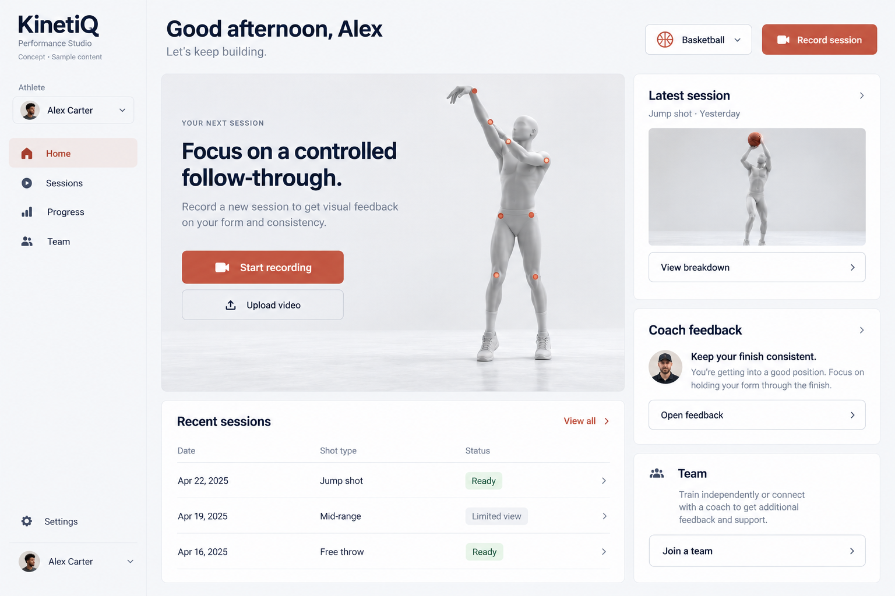
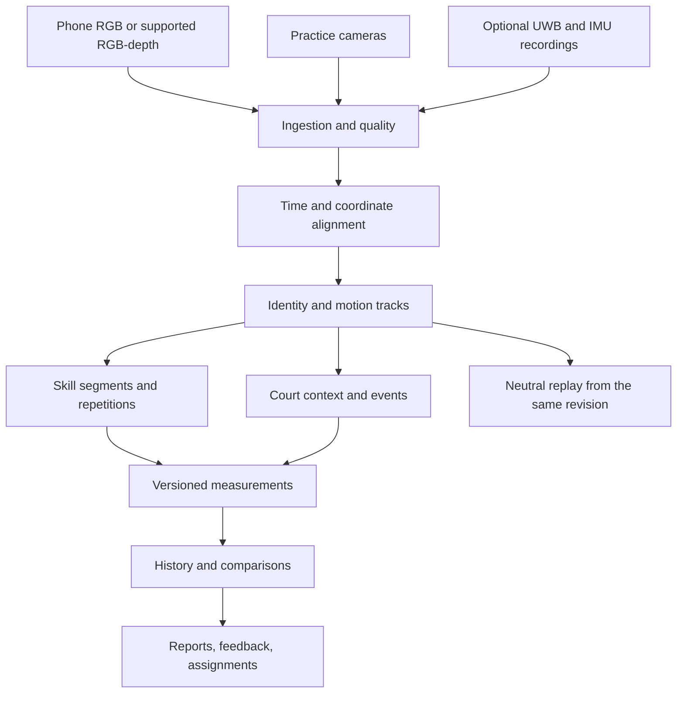

# KinetiQ — Main prototype execution base

### 2026-10-17 mannequin refinement

Implemented neutral articulated artist-mannequin appearance and smoother display playback across session/shot/saved-rig views. Display proportions remain stable; original measurements and saved revisions are preserved. Missing evidence is not interpolated across gaps over 200 ms. Validation and restart details are recorded in `skinner_implementation_checklist.md`.

## Latest execution checkpoint: 2026-10-16, reviewed basketball sessions

- [x] Local development database migrated through 0010.
- [x] Experimental ball detector/tracker integrated before source cleanup, with model provenance and explicit unavailable/partial results.
- [x] Session UI now displays image-plane ball tracks, owner shot review/correction, focused replay, per-shot body reports and quality-aware consistency.
- [x] Reviewed shots can compare supported body angles near estimated release windows; two samples are preliminary, three or more support dispersion.
- [x] Durable evaluation tooling and annotation protocol added.
- [ ] Final integrated regression/device checks and labeled accuracy study.
- [ ] Validated automatic shot boundaries/outcomes, calibrated speed/arc, spin and coach recommendations.

Implementation details: [basketball runtime](docs/design/basketball-runtime-v1.md). Current execution status: [basketball checklist](basketball_implementation_checklist.md). These entries supersede older pending database/ball implementation notes; earlier test results do not validate the final integrated batch. Unsupported metrics remain unavailable.

Created: **2026-10-04**. Status: **product, design, research, and implementation specification**.

The filename `main_protoype_excution_base.md` intentionally matches the requested spelling. This document records the conversation's decisions and provides a practical handoff for subsequent implementation. Describing a feature here does not mean it exists, has been validated, or is ready to sell.

## Contents

1. [Purpose and authority](#1-purpose-and-authority)
2. [Product direction and decision ledger](#2-product-direction-and-decision-ledger)
3. [Current repository and database](#3-current-repository-and-database)
4. [Roles, teams, and athlete ownership](#4-roles-teams-and-athlete-ownership)
5. [Sports, skills, drills, and repetitions](#5-sports-skills-drills-and-repetitions)
6. [Performance Studio design system](#6-performance-studio-design-system)
7. [Online design references and application rules](#7-online-design-references-and-application-rules)
8. [Navigation and responsive layouts](#8-navigation-and-responsive-layouts)
9. [Public website and three-sport visual](#9-public-website-and-three-sport-visual)
10. [Authentication, onboarding, and settings](#10-authentication-onboarding-and-settings)
11. [Athlete pages](#11-athlete-pages)
12. [Coach pages](#12-coach-pages)
13. [Practice capture and review pages](#13-practice-capture-and-review-pages)
14. [Hardware setup pages](#14-hardware-setup-pages)
15. [Admin pages](#15-admin-pages)
16. [UI states, accessibility, and acceptance criteria](#16-ui-states-accessibility-and-acceptance-criteria)
17. [Measurement and scoring principles](#17-measurement-and-scoring-principles)
18. [Camera, pose, and mannequin pipeline](#18-camera-pose-and-mannequin-pipeline)
19. [Practice tracking and event analysis](#19-practice-tracking-and-event-analysis)
20. [Optional hardware program](#20-optional-hardware-program)
21. [Shared architecture and data contracts](#21-shared-architecture-and-data-contracts)
22. [Storage, retention, and evidence](#22-storage-retention-and-evidence)
23. [Implementation organization and App Store path](#23-implementation-organization-and-app-store-path)
24. [Execution phases and release gates](#24-execution-phases-and-release-gates)
25. [Future validation and product economics](#25-future-validation-and-product-economics)
26. [Open decisions and resume instructions](#26-open-decisions-and-resume-instructions)
27. [Sources and provenance](#27-sources-and-provenance)

## 1. Purpose and authority

KinetiQ is intended to become an App Store deployable sports training and coaching product. The long-term ambition is approximately **10–15 sports with substantial depth within each sport**, supported by individual training analysis, team practice analysis, and optional coach hardware.

The selected frontend direction is **Performance Studio**: calm, readable, organized, with a clear next action for each role. The product loop is:

> Observe a practice or training session → inspect the evidence → choose a specific focus → assign or perform a drill → measure subsequent change → examine whether that change appears in practice.

### 1.1 How to use this document

- Use this file as the master product scope and execution sequence for the discussion consolidated here.
- Use [3d_skinner_model.md](3d_skinner_model.md) for detailed reconstruction, coordinate, fitting, artifact, and coach-query specifications.
- Re-read current repository instructions and code before implementation. The repository observations below are a dated snapshot.
- Keep product requirements, implementation proposals, external source claims, and validated KinetiQ capabilities distinct.
- Online examples guide design decisions; KinetiQ's users, accessibility requirements, existing platform, and explicit user instructions determine implementation.
- Implement bounded vertical slices. A reusable interface is useful before all sports exist; an enormous catalogue of nonfunctional screens is not a released capability.

### 1.2 Updates to the earlier 3D plan

Where the earlier plan conflicts with this document, apply these scope updates:

| Earlier assumption | Current direction |
| --- | --- |
| Visual changes limited to reconstruction workflows | A broader Performance Studio redesign is now approved as the direction |
| One movement represented by each sport plugin | Sport → skill family → skill → drill/protocol → session → repetitions |
| Coach roster primarily a personal workspace | Explicit teams, optional athlete membership, invitations, assignments, and role-based access |
| Multiple simultaneous athletes deferred without a defined product flow | Team practice analysis is a named future workflow with an early feasibility study |
| Two-phone/multi-camera work only a distant extension | Investigate synchronized court capture early; release it only after evidence supports specific outputs |
| Temporary source video for all new motion sessions | Keep the individual-training default; practice evidence retention needs a separate explicit policy before implementation |
| Hardware broadly deferred | Explore a camera-integrated UWB/IMU team kit and a focused technique sensor prototype |

The initial single-athlete, narrow-skill release remains intentional. The updated ambition does not establish that multi-player biomechanics or hardware performance has been solved.

## 2. Product direction and decision ledger

### 2.1 Agreed direction

1. **Performance Studio is the primary visual direction.**
2. Maintain athlete, coach, and platform-admin experiences.
3. Athletes can train independently and optionally join a coach's team.
4. Coaches can create teams, manage several athletes, and create managed player profiles before those players have accounts.
5. Build deep skill analysis, including multiple repetitions and history, rather than one generic score per sport.
6. Retain the neutral, untextured mannequin concept and capture-quality guidance.
7. Collect relevant measurements such as height and wingspan, with unknown values permitted.
8. Explore full practice/scrimmage analysis with player identification, events, context, and supported movement measurements.
9. Explore optional hardware for coaches while preserving the camera-only athlete experience.
10. Keep the App Store goal and existing React Native/Expo foundation.
11. Record research sources and practical limitations alongside the plan.

### 2.2 Proposals that require evidence or a later product decision

| Proposal | Current status |
| --- | --- |
| Free-throw sets as the first deep basketball skill | Recommended first vertical slice |
| UWB plus IMU tags, anchors, hub, cameras | Recommended team-hardware research direction; no custom device designed or purchased |
| Upper-arm and forearm sensors for a shooting experiment | Recommended separate technique experiment; basketball accuracy unvalidated |
| Semi-permanent partner-gym installation first | Recommended way to characterize setup before a portable kit |
| Practice source-video retention window | Proposed revision; duration, permissions, and deletion behavior unresolved |
| Composite consistency score | Deferred until the measure and its interpretation are validated |
| SAM 3D Body/MHR, Apple Vision, MediaPipe, or other provider | Candidates behind adapters; no universal winner selected |
| Product names, prices, hardware purchase/lease model | Working packaging ideas, not commercial commitments |
| Quantitative error limits and real-time processing | Must be established per metric and capture mode |
| Natural-language coach queries | Later feature layered on supported structured queries |

### 2.3 Competitive positioning

Automated filming, box scores, player highlights, wearable position tracking, and camera/sensor integration already have established competitors. Hudl, SportsVisio, KINEXON, and Catapult are research references, not evidence that KinetiQ has a unique market category. [Hudl][C01] [SportsVisio][C02] [KINEXON vision][C03] [Catapult][C05]

Working value hypothesis: KinetiQ can help its chosen customer segment connect **inspectable skill measurements, practice context, and a repeatable training workflow** at an acceptable cost and setup burden. Validate this with coaches. Do not claim competitors lack a feature based only on their public product pages.

The pasted hypothetical practice report is a vision example. Its player names, percentages, speeds, elapsed times, accuracy claims, and causal interpretations are not measured KinetiQ results. Do not reuse them as testimonials or production evidence.

## 3. Current repository and database

The following observations come from local source inspection, not from an audit of deployed infrastructure.

| Area | Current source / observation | Planned evolution |
| --- | --- | --- |
| Mobile/web frontend | [frontend/package.json](frontend/package.json): Expo 54, React Native 0.81.5, Expo Router 6, Reanimated 4.1.1, React Native SVG | Preserve native foundation; add capabilities in measured increments |
| Dependency alignment | `expo-image-picker` declares a different SDK-major line from Expo | Resolve compatibility during a focused native-build task |
| Theme | [frontend/theme/tokens.ts](frontend/theme/tokens.ts), typography, spacing, radius, motion modules | Evolve existing tokens into Performance Studio; avoid parallel styling systems |
| Athlete navigation | Home, Upload, Profile as visible tabs; other legacy routes exist | Skill-based navigation described below |
| Athlete home | [frontend/app/(tabs)/index.tsx](frontend/app/(tabs)/index.tsx) prioritizes levels, score summaries, XP, and recent sessions | Prioritize starting training and understanding feedback |
| Coach screens | [frontend/app/coach](frontend/app/coach): starter overview, athletes, sessions, profile | Persistent roster, teams, reviews, practices |
| Roles | [frontend/context/auth-context.tsx](frontend/context/auth-context.tsx): `athlete` or `coach`, stored locally | Server-backed capabilities, admin provisioning, workspace access |
| Identity | Auth0-backed login | Keep identity separate from athlete subject, team membership, and hardware ownership |
| Database | [backend/docker-compose.yml](backend/docker-compose.yml): PostgreSQL 16, local database `kinetiq`, host port 5432, named volume `kinetiq_pg` | Continue relational persistence with additive migrations |
| ORM | [backend/db/models.py](backend/db/models.py): users, user sports, analysis sessions, JSONB analysis | Add athletes, teams, practices, jobs, revisions, access grants, artifact references |
| Pose | [backend/analyzer/pose.py](backend/analyzer/pose.py): MediaPipe Heavy, one pose, normalized landmarks, visibility saved, nominal frame-index timing, RGB frames retained in memory | Timestamped provider adapters, explicit coordinates, identity and quality handling |
| Geometry | [backend/analyzer/geometry.py](backend/analyzer/geometry.py): generic angle computation with an epsilon denominator | Explicit finite/degenerate-input handling and angle definitions |
| Sport abstraction | [backend/analyzer/sports/base.py](backend/analyzer/sports/base.py), [registry.py](backend/analyzer/registry.py): one motion/phase definition per plugin | Versioned sport/skill/protocol registry |
| Pipeline | [backend/analyzer/pipeline.py](backend/analyzer/pipeline.py): metrics → segmentation → score → rendering | Separate capture, tracking, reconstruction, events, metrics, reporting, and presentation |
| Upload/result lifecycle | Earlier audit in the 3D plan identifies public `/analyze` and client-posted session JSON | Authenticated, server-owned sessions and durable jobs |
| Legacy imagery | Original-frame GIFs/JPEGs can remain inside saved analysis | Explicit legacy classification; neutral derived previews for new body-only sessions |

Do not describe Auth0 or AsyncStorage as the analysis database. Do not infer the current production deployment or live database contents from Docker configuration.

Existing unrelated edits include deleted `docs/superpowers` files, role/UI changes, folder readmes, and duplicate filenames containing ` 2`. Preserve them. The user requested removing `docs/superpowers`; this plan does not restore it. When organizing backend/frontend folders in future work, preserve the user's convention: a minimal text file named `<foldername>_readme` explains each relevant folder. Do not bundle a broad cleanup into a feature task.

## 4. Roles, teams, and athlete ownership

### 4.1 Roles and access

| Role | Main purpose | Entry and default destination |
| --- | --- | --- |
| Athlete | Personal skill training, history, optional coaching | Public signup choice → athlete Home |
| Coach | Roster, teams, assignments, reviews, practices | Public signup choice → coach Overview |
| Platform admin | Accounts, controlled access, operational issues, feature configuration | Explicit provisioning → separate admin console |

- Admin is not a public signup option.
- A user may later hold both athlete and coach capabilities. A workspace switch changes context; it does not grant permissions.
- Camera-only versus hardware-assisted capture is a capability of a session/setup, not a role.
- A coaching subscription or device purchase does not grant access to unrelated athlete records.
- Implement and enforce authorization on the server for reads, writes, jobs, artifacts, exports, comparisons, and model queries.
- Scope caches by account/workspace and clear protected state on logout or access change.

### 4.2 Identity relationships

An account is a login identity. An athlete profile is the person being analyzed. A coach may create a managed athlete profile with no login account. A team is a sporting group; a workspace is the ownership/administrative context; membership and sharing are explicit relationships.

Store jersey assignment for a particular team/practice/time interval. A jersey number is not a permanent athlete ID. Do not link real accounts solely through names, email guesses, or jersey OCR.

### 4.3 Team lifecycle

1. Coach creates a team with name and sport.
2. Coach adds managed profiles or creates invitations for existing/new accounts.
3. Invitation can be accepted through a link, QR code, or entered team code.
4. Athlete previews team identity, coach, requested relationship, and data-sharing behavior.
5. Athlete explicitly accepts or declines. Invalid, expired, revoked, and already-used invitations have clear recovery states.
6. Earlier private sessions remain private unless explicitly shared.
7. New-session sharing follows the athlete's selected policy and is visible before submission.
8. Leaving a team stops future access under that membership, subject to an explicitly defined ownership/retention policy; personal history remains with the athlete.
9. Coaches can archive roster entries without silently deleting the athlete or all historical sessions.

Managed profiles require a verified claim/link flow. If the claimant already has a profile, show the proposed merge and its access effects; preserve source history and audit the change. Do not silently overwrite records.

### 4.4 Practice publication and privacy

Coaches see authorized practice data. Athletes receive their own published findings and appropriately scoped evidence. Teammates do not automatically receive each other's body measurements, private coach notes, or full practice access. A multi-person evidence clip can contain other athletes even when linked to one person's report; define sharing at artifact level.

Guardian authority and managed-player ownership must be resolved for the actual audience before releasing dependent youth-account features. No facial recognition is required by this plan; athlete identity can use roster assignment, tags, jersey evidence, appearance, and motion association.

## 5. Sports, skills, drills, and repetitions

### 5.1 Canonical hierarchy

```text
Sport → Skill family → Skill → Drill / capture protocol
                                ↓
                             Session
                                ↓
                           Repetitions
                                ↓
              Phases, measurements, quality, outcomes
```

Individual training and practice-derived actions must link to the same athlete history while retaining their different capture and context metadata.

### 5.2 Basketball depth roadmap

These are catalogue candidates, not shipped capabilities:

| Family | Candidate skills / variants |
| --- | --- |
| Shooting | Free throw, catch-and-shoot three, off-dribble three, midrange jumper |
| Finishing | Layup, reverse layup, left/right finishing, finishing through contact |
| Defense | Defensive stance, lateral shuffle, closeout |
| Handling and footwork | Crossover, first-step acceleration, pivot/post footwork, change of direction, deceleration |
| Jumping and landing | Jump mechanics, landing mechanics, rebounding jump |
| Passing and running | Passing mechanics, sprint mechanics |

Define variations carefully: a shot location or preparation type may be a parameter within a shared skill family. Twenty listed skills do not automatically imply twenty separate neural networks. Each released skill still requires its own supported conditions and interpretation.

### 5.3 Skill definition contract

Each versioned skill definition must include:

- Stable sport, family, skill, and protocol identifiers, labels, and supported variants.
- Capture requirements: view, subject scale in image, visible segments, timing, environment, devices, optional sensors.
- Whether ball, court, equipment, stimulus timing, or multiple people must be observed.
- Repetition segmentation and phase definitions, including manual corrections where needed.
- Named metrics with units, anatomical conventions, dependencies, and unavailable reasons.
- Quality requirements per metric; quality may differ between metrics in the same session.
- Comparison eligibility: movement variant, distance/context, handedness, sensor mode, coordinate conventions, and method version.
- Reference/target provenance and allowed coaching statements.
- Validation record and availability: internal experiment, pilot, or supported release.
- UI instructions and sample recording guidance.

Free-throw sets are the proposed first deep skill. A session should retain all detected attempts, accepted attempts, excluded attempts with reasons, and coach/user corrections. Do not require one upload per attempt.

### 5.4 Long-term sport expansion

Share accounts, capture, timing, jobs, storage, quality schemas, tracking, rendering, and report infrastructure. Keep sport rules, equipment, event semantics, scoring definitions, and validation modular. The earlier suggestion that 70–80% can be shared is not an evidence-based estimate. A second meaningfully different sport is an architectural learning milestone before scaling to 10–15.

## 6. Performance Studio design system

### 6.1 Selected direction and preserved visual references

Reading this as: **an athlete training app and coach workspace with a calm athletic identity, using Performance Studio as the shared visual system**.



The image was generated in this conversation as a visual concept using the built-in image-generation tool. It is not an implemented screen, a scientific rendering, or a copied external design. The written specification overrides incidental image details: repeated primary buttons, sample dates/names, generated wording, and approximate anatomical points are not requirements.

| Earlier concept | Decision | Ideas retained |
| --- | --- | --- |
| [Performance Studio](docs/design/references/performance-studio-concept.png) | Selected overall direction | Clear personal next action, calm shell, purposeful replay, focused coaching |
| [Clubhouse](docs/design/references/clubhouse-concept.png) | Alternative retained for reference | Assignment organization, team activity, review queues; retain Performance Studio colors/type |
| [Motion Lab](docs/design/references/motion-lab-concept.png) | Alternative retained for reference | Detailed coach viewer, timeline, inspector, evidence controls; retain shared app shell |

All three are illustrative desktop references. Mobile layouts below are first-class specifications, not scaled-down desktop screenshots. The generated artwork is not an app-store screenshot or proof of a capability. An additional note with provenance and generation briefs lives in [references_readme](docs/design/references/references_readme).

### 6.2 Visual hierarchy

- Each page begins with a useful title and an obvious next action.
- Athlete Home emphasizes starting a session and understanding a current focus.
- Coach Overview emphasizes pending reviews and findings that deserve attention.
- Detailed analysis belongs in the session workspace, with measurements revealed as needed.
- Prefer rows and separators for collections; use cards only when they group a meaningful unit.
- Use one icon family through the existing icon wrapper, with consistent stroke weight.
- Keep photography on public/product-introduction surfaces and deliberate examples. Use neutral derived previews in persistent body-only session history.
- Keep public copy concise and specific. Product UI should not expose provider names, infrastructure, or internal job jargon unless the user needs it for a decision.

### 6.3 Starting design tokens

These are implementation proposals to refine through rendered review, not certified contrast results:

| Token | Starting value / rule |
| --- | --- |
| Light canvas | `#F5F6F8` |
| Primary surface | `#FFFFFF` |
| Primary ink | `#11151C`; navy headings/navigation `#212D40` |
| Secondary text | Existing steel/slate family, adjusted for readable contrast |
| Brand accent | Terracotta; evaluate `#B94F3C` for filled controls and a lighter tonal surface for selection |
| Existing accent | `#D66853` is in current tokens; check text/control contrast before retaining it in each role |
| Viewer surface | Charcoal for detailed replay where it improves model legibility |
| Data/status colors | Small stable semantic set; pair color with words/icons |
| Typography | Native system sans for the app; consistent sans family on web; evaluate any custom font before adding it |
| Body text | Starting target 16–17 logical units; preserve platform text scaling |
| Page heading | Starting target 28–34 on phone; larger public-site headings only where they fit |
| Spacing scale | 4, 8, 12, 16, 24, 32, 48; central tokens rather than arbitrary per-screen values |
| Phone gutters | Starting target 16–20; respect safe areas |
| Desktop gutters | Starting target 24–40, with readable content widths |
| Corners | Restrained 10–14 for grouped surfaces; tighter controls where appropriate |
| Elevation | Subtle shadows for actual elevation; borders/dividers for structure |
| Touch controls | Project target of at least 44 × 44 logical units; do not overlap enlarged hit regions |
| Number columns | Tabular numerals, explicit units, stable precision |

Use the existing theme modules as the source of truth. System appearance and a user preference can select light/dark; both require intentional tokens. A dark analysis viewport does not require the whole app to be dark.

### 6.4 Component rules

- Buttons: primary, secondary, subtle, destructive; consistent labels, heights, loading, focus, disabled states.
- Forms: visible labels, contextual examples, field-level errors, correct keyboard/input type, retained values after recoverable failures.
- Lists: clear row target and optional secondary actions; avoid nested press targets with ambiguous behavior.
- Tables: aligned headers and units; responsive row equivalents for mobile; pagination or virtualization for long rosters and event lists.
- Filters: active values visible; Clear filters; empty-result recovery; persistent state where appropriate.
- Tabs: stable labels and selected state; preserve relevant scroll/playback context.
- Dialogs/sheets: one purpose, clear close/cancel, accessible focus behavior, safe-area and keyboard handling.
- Charts: labeled axes, units, sample count, quality context, accessible text summary, and links to supporting sessions.
- Media viewer: explicit play/pause, speed, phase/repetition navigation, reset, fullscreen; provide button alternatives to gestures.
- Feedback: AI attribution and coach attribution remain visible; draft/published states are distinct.
- Notifications: relevant and actionable; badge counts describe pending work rather than decorative engagement.

### 6.5 Motion rules

Use brief transitions to explain changes of state, not to delay normal work. Proposed starting ranges are roughly 120–180 ms for simple feedback and 180–280 ms for sheets/panels; tune by platform and interaction. These are KinetiQ design defaults, not empirical performance guarantees.

- Use existing Reanimated for native interface motion and SVG overlays where appropriate.
- On web, select one main animation approach. Motion is a candidate for component/layout transitions; GSAP or Anime.js can serve a specific hero sequence when justified.
- Do not stack Motion, Anime.js, and GSAP as three competing engines for the same controls.
- Honor reduced motion on native and web. Provide static cues for state changes.
- Avoid repeated entrance animations on high-frequency roster/review interactions.
- Keep animation interruptible, and do not tie successful saving or navigation to an animation completing.
- Keep metric digits stable while the user reads them. Viewer motion represents recorded/reconstructed movement; decorative animation must not alter it.
- Avoid scroll hijacking, cursor trails, perpetual particles, gratuitous tilt, and animated backgrounds behind measurements.

## 7. Online design references and application rules

All named references from the design request are mapped below. This is deliberate application of their relevant ideas, not a claim that their sometimes conflicting examples should all appear together.

| Reference | What it informs | KinetiQ implementation boundary |
| --- | --- | --- |
| [Taste Skill][D01] | Deliberate composition, typography, whitespace, distinctive public presentation | Main skill focuses on public pages; do not impose landing-page composition on dense coach tasks |
| [Manus][D02] | Task-oriented starting point with few understandable actions | Athlete training and coach review remain directly navigable; chat is optional later |
| [Skiper UI][D03] | Selected image reveals and polished interactions | Corrected user URL is `skiper-ui.com`; web/shadcn examples need native equivalents |
| [Motion][D04] | Layout continuity, tabs, sheets, expanding content on React web | Reanimated serves native surfaces |
| [Anime.js][D05] | SVG and coordinated timelines | Candidate for tracking-overlay introduction on web |
| [React Bits][D06] | Selective visual inspiration and public-site components | Browser React/CSS examples; inspect dependencies and license before reuse |
| [Vercel guidelines skill][D07] and [current rules][D08] | Forms, semantics, focus, accessibility, loading, responsive behavior | Apply HTML-specific rules to web and equivalent native semantics to React Native |
| [Image-to-Code][D09] | Establish readable visual references before coding and compare resulting composition | Use separate large screen references; generated pixels are not a substitute for accessible components |
| [Awesome Design MD][D10] | A documented, consistent design system | Community brand analyses are not official brand specifications; create a KinetiQ system |
| [Impeccable][D11] | Clarify hierarchy, remove excess, normalize and polish | Apply within the chosen system; avoid rewriting the design on each new screen |
| [Transitions.dev][D12] | Panel reveal, tab indicator, skeleton-to-content transitions | Assumed correction of user spelling `transistions.dev`; selected patterns only |
| [GSAP skills][D13] and [timeline guidance][D14] | Coordinated multi-stage hero choreography | No default need for GSAP in the native app |
| [Make Interfaces Feel Better][D15] | Optical alignment, icon consistency, hit areas, number stability, motion restraint | Assumed intended repository; adapt web syntax to native behavior |
| [Playwright CLI][D16] | Future browser interactions and screenshots | Implementation review tool; it cannot validate native camera modules or scientific accuracy |
| [Reanimated accessibility][D17] | Native reduced-motion behavior | Honor system preference rather than forcing motion on |
| [W3C contrast][D18] and [pause/stop guidance][D19] | Readability and control over moving content | Measure actual shipped states; a cited guideline is not a completed audit |

Research these official/current sources again when selecting components, pin adopted versions or commits, and record licenses. Do not install every referenced skill or library simply because it is listed here. Public examples and promotional claims do not establish native compatibility, accessibility, or KinetiQ accuracy.

## 8. Navigation and responsive layouts

### 8.1 Athlete shell

- Phone tabs: **Home · Skills · Sessions · Progress · Team**.
- Header: current page, sport selector when relevant, profile/avatar; notifications only when useful.
- Primary recording action on Home, Skill detail, and Sessions; action buttons do not masquerade as navigation tabs.
- Team remains a stable destination with a useful independent-athlete state.
- Desktop/tablet: sidebar with the same destinations; primary content and optional contextual column.
- Profile, preferences, privacy, and account actions live under the avatar/settings entry.

### 8.2 Coach shell

- Desktop: **Overview · Teams · Athletes · Skills & Assignments · Practices · Reviews**.
- Phone tabs: **Overview · Athletes · Practices · Reviews**.
- The mobile workspace/team selector opens a clear **Manage teams** destination. Overview and athlete detail link directly to assignments.
- Header: selected workspace/team, contextual primary action, optional search/notifications, profile.
- Athlete detail and practice detail retain parent context and sensible back navigation.
- Detailed review opens a focused workspace; tablet/desktop can show viewer and inspector together.

### 8.3 Admin shell

- Separate web console: **Overview · Accounts · Teams · Processing · Configuration · Audit**.
- Hardware operations can be introduced as a scoped section when devices exist.
- Header contains page title, contextual search, and admin identity.
- Public role selection never links directly to administrative privileges.

### 8.4 Responsive behavior

Initial web layout proposals: single column below approximately 768 CSS px; adaptive tablet/master-detail around 768–1199; persistent wider sidebar/workbench at larger widths. Select breakpoints by actual content and text scaling, not device names. Native layouts use available dimensions and safe areas.

- Desktop tables become concise mobile rows; opening a row reveals secondary information.
- A three-column coach workbench becomes viewer + Summary/Measurements/Notes tabs on phone.
- Comparison uses side-by-side viewers on wide screens and A/B switching or stacked views on phone.
- Routine app screens have no marketing footer. Public pages have legal/help navigation. Focused capture/review uses an action/playback toolbar.
- Retain unsaved note state, selected athlete, filters, and session context across appropriate navigation.
- Web URLs and native deep links should reopen authorized teams, practices, sessions, and invitations; authorization is checked on entry.

## 9. Public website and three-sport visual

### 9.1 Landing page

**Latest implemented direction, 2026-10-05:** the owner supplied three real video files. The welcome page now plays tennis, basketball, and running in three equal, edge-to-edge segments, with the account section below the opening viewport. Playback is muted and looping, with real extracted poster frames, pause/play controls, reduced-motion support, and offscreen/background pausing. The original files remain unchanged. Optimized copies are bundled under `frontend/assets/videos/welcome/`.

The latest visual rules use flat warm-neutral surfaces, square controls, restrained ink/rust colors, and Helvetica/Arial/platform sans. No illustrated people, gradients, shadows, glass, decorative feature-card row, sparkle icons, hover animations, em-dash copy, testimonial/pricing sections, or legal sections are added to this welcome page. See [frontend rules](docs/design/frontend-rules.md) and [video provenance](frontend/assets/videos/welcome/sources.md). This supersedes the illustrated implementation and the earlier photo-only requirement.

**Earlier user direction, 2026-10-04 (superseded by the supplied-video implementation):**

- Use **real photographs of people actively playing sports** on the main welcome page. Source accessible photos that we have permission to use, and record their source and usage rights. Drawings, illustrated silhouettes, and generated substitutes do not satisfy this direction.
- Arrange exactly **three photographs in three adjacent vertical segments**, spanning the full screen width from left to right. Use equal-width segments and intentional crops that keep the athletes and sporting action visible. Keep this opening triptych full-width rather than inside a narrow card or beside the signup form.
- Place the **“Your work starts here.”** section **below the image triptych**. Visitors scroll down to reach the athlete/coach choices and sign-in/signup controls. The photos and account section must not sit side by side.
- Preserve the three-segment composition responsively, with suitable photo crops and an adapted hero height. Keep the account form readable below it.
- This direction replaces the current illustrated welcome visual and its desktop side-by-side account layout. The optional video-to-tracking treatment below is a later enhancement; the next visual revision starts with real photography.

**Header:** KinetiQ logo, How it works, For athletes, For coaches, Sign in, primary **Get started**. Compact responsive menu on phone.

**Main content:** concise product promise; three-sport visual; paths **Train as an athlete** and **Coach a team**; record/review/practice walkthrough; athlete benefits; coach benefits; honest explanation of supported capabilities. Hardware section appears as a clearly labeled pilot or available product according to actual status.

**Footer:** Help, Contact, Privacy, Terms, account/data information, and App Store destination only when available. Avoid fabricated customer logos, reviews, accuracy percentages, and download badges.

Public Athlete and Coach detail pages may expand these sections without inventing separate navigation systems. Their primary actions lead to the appropriate onboarding context. Hardware details must identify installation and capability requirements rather than implying that every metric improves automatically.

### 9.2 Three-sport storyboard

| Stage | Required behavior |
| --- | --- |
| Poster | Stable three-panel sports composition loads before video; text and signup remain usable |
| Movement | Three adjacent desktop panels show short movements; proposed examples are basketball, tennis, and a selected roadmap sport |
| Freeze | Each pauses on an exact selected frame extracted from its own source clip |
| Tracking | Corresponding points and connecting lines appear in the same crop/coordinate transform |
| Explanation | One concise movement/phase label; illustrative and measured overlays are explicitly distinguished |
| Optional mannequin | One panel can reveal a neutral mannequin demonstration, labeled appropriately |
| Controls | Play/pause and replay; reduce-motion/static alternative; motion stops when offscreen as appropriate |

Do not substitute an unrelated photograph at the freeze point. Preserve timestamp, aspect ratio, crop, scaling, and landmark transform. Use owned, licensed, or appropriately authorized footage; no real athlete history is needed to render the public demo. Precompute the demonstration instead of running the analysis pipeline for every visitor.

Phone adaptation: retain the full-width three-photo triptych with responsive crops and height, followed by the account section below. If the optional animation is added later, avoid shrinking three detailed tracking animations into unreadable columns; a separate focused playback view may follow the photo composition. Muted playback is deliberate, with a static fallback if autoplay fails. Keep scrolling and access to login available throughout the sequence. Show the installed-app welcome briefly; do not replay marketing every time the athlete opens Home.

Suggested timing is a short movement segment, a readable freeze/overlay hold, then stop or explicit replay. Exact timing follows asset and usability review. Unsupported sports say concept/upcoming; illustrative overlays are not marketed as validated output.

## 10. Authentication, onboarding, and settings

### 10.1 Welcome and authentication

- **Purpose:** enter the correct experience quickly.
- **Header:** logo and back navigation where appropriate.
- **Content:** concise explanation, sign-in/signup controls, first-time Athlete/Coach choice with one-sentence descriptions.
- **Buttons:** Sign in, Create account, Continue; provider/recovery controls according to actual Auth0 configuration.
- **Footer:** Terms, Privacy, Help.
- **Returning user:** restore last authorized workspace, without repeating role selection.
- **States:** authentication in progress, canceled, expired, recoverable failure, missing onboarding step, invalid invitation. Preserve invitation context through authentication.

### 10.2 Athlete onboarding

Sequence: identity/name → sport and dominant side → height/wingspan and units → optional team → recording guidance. Reconcile this with existing username onboarding without creating duplicate profiles.

Provide brief measurement instructions, **I don't know**, and **Skip for now**. Do not encode unknown height or wingspan as zero. Explain why a dimension is requested and how to update it. Record method (self-reported/coach-measured/etc.), date, units, actor, and immutable measurement version. Camera-derived estimates have separate provenance.

**Buttons:** Back, Continue, Skip for now, Enter team code, Finish, Record first session. Keep forms short, resumable, and usable with larger text.

### 10.3 Coach onboarding

Collect coach name, optional organization, primary sport, and optional first team. A coach does not need to enter personal body dimensions unless also creating a self athlete profile.

**Buttons:** Create team, Add first athlete, Invite athletes, Set up later. The coach can reach Overview before completing a full roster or owning hardware.

### 10.4 Team invitation/claim screen

Show who invited the athlete, team/sport, target player profile if applicable, and the sharing effect. Provide Accept, Decline, and a way to correct an incorrect identity. Show expired/revoked/incompatible-link states clearly. A coach-created profile claim and a generic team join are distinct actions.

### 10.5 Profile and settings

Sections: personal information; sports and measurement versions; authorized workspaces; team relationships; sharing and retention; notifications; accessibility/appearance; help; account export/deletion.

**Header:** Settings with back navigation. **Buttons:** Edit profile, Update measurements, Manage sharing, Save changes, Sign out, relevant account actions. Explain consequences of leaving a team or deleting a session at the point of action. Historical session measurements do not silently change after a profile update.

## 11. Athlete pages

### A01 — Home

**Header:** greeting, active sport selector, profile; avoid repeating the full marketing headline.

**Content order:** current training focus → prominent Start training → latest completed result → coach-assigned work/feedback when present → relevant practice finding published by a coach → recent sessions. Optional team connection is modest and dismissible in emphasis.

**Buttons:** Start training, Upload video, View latest result, Open assignment, View evidence, View all sessions. Choose one primary action for the current state; avoid the duplicated equally prominent capture buttons shown incidentally in the concept image.

**First use:** a short recording guide and Record your first session. **Returning state:** meaningful recent information. XP, levels, and generic best-score cards are secondary or deferred. Do not show empty coaching placeholders to independent athletes.

### A02 — Skills catalogue

**Header:** Skills, selected sport, search.

**Content:** supported skill families; readable rows or modest cards showing skill name, description, recent activity, and availability. Filters can narrow family and favorites when useful. Do not expose 15 empty sport categories as a working catalogue.

**Buttons:** Open skill, Change sport, View recent training. Unsupported skills belong in an explicitly labeled roadmap area if displayed at all.

### A03 — Skill detail / drill setup

**Header:** skill name and sport/family breadcrumb on wide screens.

**Content:** what the analysis covers; recording guide; supported measurements; drill/protocol selection; relevant handedness/variant/distance; recent results; assigned focus. Ask only for context used by that skill.

**Buttons:** Start session, Upload clip, View recording guide, View history. The primary action stays reachable on phone. Camera/sensor requirements are shown before recording; users can choose an available mode.

### A04 — Capture and import

**Header:** close/back, selected athlete, skill, capture mode. Athlete identity remains visible when a coach records on someone's behalf.

**Content:** record/import choice; framing example; live checks where supported; video preview; trim boundaries; selected athlete where ambiguity exists; sharing choice. Imported video gets post-import checks rather than pretending those checks occurred live.

**Buttons:** Record, Stop, Choose video, Retake, Use clip, Analyze session. Main navigation is hidden during active capture; essential controls remain within safe areas.

Guidance is specific: feet out of frame, arm obscured, multiple possible subjects, insufficient light or motion blur, supported view missing. Classify blocking and advisory issues per metric/protocol. Some useful output may remain possible with partial visibility; do not promise full analysis because the body detector found a person.

### A05 — Upload and processing

**Header:** session title and back navigation.

Show real status such as Uploading, Checking recording, Analyzing movement, Preparing report, Needs input, Ready, or Failed. Use numerical progress only when a real denominator exists. The athlete can leave and return to a durable job. Separate network transfer from server processing.

**Buttons:** Return Home, Open session, Retry failed stage, Resume upload, Cancel where supported. Errors retain recoverable local work. Notification permission is requested in context, not made a condition of analysis.

### A06 — Training session result

**Header:** skill, date, source mode, overall quality summary, overflow actions.

**Content:** neutral replay → set summary → repetition selector → phase timeline → two or three prioritized supported observations → next practice focus → expandable measurements → separately attributed coach feedback. Accepted/excluded attempt counts are visible.

**Viewer controls:** Play/Pause, speed, previous/next repetition, phase selection, reset view, fullscreen, overlay toggle. **Actions:** Compare attempts, Review excluded attempt, Repeat drill, Share with coach, Manage sharing.

A limitation can be specific to one angle or time interval. Show Unavailable with the reason; keep legitimate measured zero values where the defined convention allows them. Do not rotate a 2D skeleton and label it measured 3D.

### A07 — Repetition / phase detail

**Header:** session context, repetition number, selected phase.

**Content:** focused replay, supported values and units, source evidence, timing, quality reason, and relevant note. Corrections to segmentation are versioned when available.

**Buttons:** Previous/Next, Back to set, View measurement explanation, Flag an issue, permitted Adjust phase. Preserve the user's selected repetition and playback position when returning.

### A08 — Sessions

**Header:** Sessions, Start training.

**Content:** search/filter by sport, skill, date, source, quality, and sharing; rows with neutral preview, skill, date, attempt summary, status. Individual sessions and practice-derived actions retain provenance.

**Buttons:** Open, Filter, Clear filters, Compare selected, Manage sharing. Completed, processing, failed, and limited-view sessions have distinct labels. Use collection pagination/virtualization and accessible row actions.

### A09 — Compare

Select two eligible sessions or repetitions. Show matching skill/context and any material differences in capture method, measurement definition, or quality. Do not silently compare incompatible versions.

**Desktop:** two viewers with synchronized phase alignment where supported. **Phone:** stacked views or explicit A/B control with one shared timeline.

**Buttons:** Change A/B, Align by phase, Play both, Reset views, Open source session. A summary states sample counts and limits; smoothing/alignment must not create apparent improvements.

### A10 — Progress

**Header:** sport/skill and date range.

**Content:** training frequency, current focus, one selected measurement trend, consistency measures, observed outcomes where supported, links to contributing sessions. Separate practice and structured-drill contexts or clearly label their combination.

**Buttons:** Change skill, Change measure, Change date range, Open session, Compare. Explain insufficient data instead of drawing a confident trend from a few low-quality attempts. Do not combine all sports into one unexplained technique score.

### A11 — Team and assignment detail

**Independent state:** optional coaching explanation with Enter code/Open invitation; personal training remains complete.

**Connected state:** team/coach identity, active assignments, published feedback, relevant practice reports, membership and sharing settings. Team switching is explicit if multiple teams are supported.

**Assignment detail:** purpose, instructions, skill/protocol, optional due date, examples, submitted attempts, attributed feedback.

**Buttons:** View assignment, Record submission, Upload submission, Open feedback, Manage sharing, Leave team. Before submitting, display recipients. A private save option is offered only where it is consistent with the assignment's workflow.

### A12 — Athlete practice finding

**Header:** practice name/date, publishing coach, skill/player context.

**Content:** observation, supporting event count, accessible evidence, coverage/limitations, suggested training. It is a scoped athlete view rather than an automatic copy of the coach's whole-team report.

**Buttons:** View evidence, Open assigned drill, View related sessions, acknowledge/reply if implemented. Expired source video leaves a clear evidence-availability notice and any still-supported derived replay.

## 12. Coach pages

### C01 — Overview

**Header:** workspace/team selector, profile, contextual Add athlete or New practice action.

**Content order:** sessions/findings to review → draft feedback → recent athlete submissions → active assignments → practice processing/identity tasks. Each finding displays a concise observation, supporting sample count, limitations, and a source link.

**Buttons:** Review next, View evidence, Assign training, Dismiss finding, Resume draft, Add athlete, New practice. Avoid six equally emphasized primary actions; select the primary by the current workflow. Empty state offers Create team/Add athlete.

### C02 — Teams list and create

**Header:** Teams, Create team.

**Content:** team name, sport, roster count, recent practice, pending review count. **Create form:** name, sport, optional description/organization.

**Buttons:** Open team, Create team, Cancel. Creation does not automatically send invitations. Empty state offers an immediate useful action.

### C03 — Team detail

**Header:** team identity, sport, contextual primary action.

**Tabs:** Overview · Roster · Training · Practices · Settings. Overview can include a concise authorized activity list.

**Buttons:** Add athlete, Invite athletes, Copy invite link, Show QR, Create assignment, New practice, Manage membership. Settings cover team metadata, permitted staff roles when supported, invitation expiration/revocation, and archive behavior.

### C04 — Athletes list / add player

**Header:** search, team/sport filters, Add athlete.

**Desktop table:** athlete, team, current focus, latest session, review status. **Mobile rows:** name, latest activity, priority status; open for details.

**Add flow choices:** Create managed player or Invite athlete. Collect identity/display information, sport/dominant side, known measurements, optional jersey for the relevant context. Make unclaimed status visible without implying the player has logged in.

**Buttons:** Save player, Invite, Cancel, Open athlete. Handle duplicate candidate profiles with a deliberate resolution flow.

### C05 — Athlete detail

**Header:** athlete name, team relationship, New session.

**Tabs:** Overview · Sessions · Progress · Measurements · Notes. Practice involvement is reachable from Overview/Sessions with a clear source filter.

**Content:** current focus, authorized history, assignments, published/draft coach notes, measurement provenance. Private coach notes and athlete-visible feedback are distinct.

**Buttons:** Review latest, Record for athlete, Request session, Assign focus, Compare sessions, Add note, Edit permitted measurements. No visibility into unshared personal history merely because the athlete joined the team.

### C06 — Skills and assignments

**Header:** Skills & Assignments, Create assignment; catalogue and assignment tabs where useful.

**Content:** supported skill catalogue, active/draft/completed assignments, team/athlete filters, submission counts. Assignment creation includes title, skill/protocol, instructions, recipients, optional date, and authorized examples.

**Buttons:** Save draft, Preview athlete view, Publish assignment, Open submissions. Publish is explicit; recipients and sharing effect are visible. Avoid adding a full calendar/attendance product before a demonstrated need.

### C07 — Review queue

**Header:** Reviews, filters for team, athlete, skill, assignment, source, and review state.

**Content:** submissions requiring attention, draft reviews, processing/quality exceptions, and clearly separated identity/event correction tasks. Sort by useful criteria rather than opaque urgency.

**Buttons:** Review next, Open, Resume draft, Filter. Preserve queue position after completing a review. A coach can review one athlete without loading a full practice's rich geometry.

### C08 — Session review workspace

**Desktop:** selected athlete/session context at left, central viewer, measurement/note inspector at right, timeline at bottom. Use Performance Studio shell and the useful spatial organization from Motion Lab.

**Phone:** viewer above Summary/Measurements/Notes tabs; important playback controls remain reachable.

**Header:** athlete, skill, date, draft/published state. **Controls:** playback, speed, phase/repetition, viewpoint, overlay, reset. **Actions:** Save draft, Add timestamped note, Compare session, Publish feedback, Return to queue.

Measurements include units, definition, method, and availability. Anatomical reference changes and model-view rotation must not be represented as newly observed camera angles. Original footage is an optional authorized evidence view only while retained.

### C09 — Structured measurement explorer, later phase

**Fields:** athlete/session, repetition, interval, phase, body segment, supported metric, comparison set.

**Output:** numeric values/series, units, coverage, reconstruction/metric revisions, measurement context, reason for unavailable results.

**Buttons:** Apply, Reset, Save view, Export permitted report, Open evidence. Natural-language queries may later translate into this allowlisted structure and must return their underlying evidence and limits. The interface does not execute arbitrary model/server code.

## 13. Practice capture and review pages

### P01 — Practices library

**Header:** Practices, New practice.

**Content:** date, team, duration where known, source count, processing state, outstanding corrections, publication status. Filters for team/date/state.

**Buttons:** New practice, Import recordings, Open report, Resume setup/upload. A setup draft is distinct from an actual completed recording.

### P02 — Practice setup and roster

**Header:** new practice, step indicator.

**Content:** name/date, sport, venue/court, participating teams, roster, jersey assignments, expected sources, recording/retention mode. Distinguish active players, substitutes, coaches, officials, and unresolved people where relevant.

**Buttons:** Add participant, Confirm roster, Add camera, Add sensors, Continue, Save draft. Duplicate numbers across opposing teams are valid; identity keys include team/context rather than treating number alone as unique.

### P03 — Camera coverage, calibration, synchronization

**Header:** setup state and selected court.

**Content:** each camera's preview/source metadata; court coverage diagram; calibration status; synchronization check; blocked/advisory issues. Imported recordings have a separate alignment workflow. Explain what measurements the current setup can support.

**Buttons:** Pair/add source, Check coverage, Calibrate, Check synchronization, Recalibrate, Continue. A moved camera invalidates the affected calibration. Tapping Start on several phones does not establish frame synchronization.

### P04 — Recording and upload status

**Header:** practice name, elapsed recording time, recording state.

**Content:** per-source recording status, battery/storage/connection where available, interruptions, upload progress, event markers if supported. Local recordings and cloud completion are separate states.

**Buttons:** Start, Stop with clear effect, Mark interval, Resume upload, Finish setup. A dropped source produces a recorded gap and a capability downgrade; do not display a complete high-quality session when inputs are incomplete.

### P05 — Processing overview

**Content:** actual stages, available partial outputs, per-source failures, identity/event tasks awaiting input, source retention deadline. Independent completed work survives a recoverable failure.

**Buttons:** Review identities, Review events, Open provisional report, Retry eligible stage, Return later. Reports remain visibly provisional until required evidence is resolved; unresolved players need not block every valid team observation.

### P06 — Identity review

**Header:** practice, unresolved count, filter by team/time/source.

**Content:** track previews/timeline, candidate athlete, evidence such as number/tag/trajectory, confidence category, ambiguous intervals. Do not require the coach to interpret raw probability values without calibration.

**Buttons:** Confirm player, Correct assignment, Split track, Link fragments, Leave unknown, Undo correction. Show the time interval affected. Version corrections and invalidate/recompute downstream aggregates; never silently transfer one player's history to another.

### P07 — Event review

**Header:** supported event type filters and pending count.

**Content:** candidate shot/pass/etc., timestamp, actor, outcome, evidence, alternatives/unknown state. Only show event categories implemented for the selected sport.

**Buttons:** Confirm, Edit actor/time/type/outcome, Add missed event, Reject duplicate, Leave unknown. Make manual corrections first-class evidence with author/time and preserve model predictions for evaluation.

### P08 — Practice report

**Header:** practice/team/date, duration, publication state, quality summary.

**Content order:** findings to review → coverage and unresolved limits → team/player summaries → supported event timeline → tactical/positional view → selected skill observations → training recommendations. Distinguish measured findings from hypotheses.

Each finding includes scope, supporting event count, comparison context, evidence link, and limitations. A report must not imply complete tracking from a partial clip. A positional map may be more faithful than a detailed mannequin where body reconstruction is unsupported.

**Buttons:** View evidence, Filter player, Compare practice, Assign drill, Save draft, Publish selected findings, Export authorized report. Athlete publication is explicitly scoped.

### P09 — Player practice detail

**Header:** athlete, jersey/team for this practice, observation coverage.

**Content:** supported participation intervals, movement summaries, events, selected reconstructable actions, comparisons to eligible practice history, coach notes. Distinguish time present in the recording from verified playing time.

**Buttons:** Open event, Compare actions, Open skill analysis, Assign focus, Publish feedback. Measurements inferred from a wearable attachment point use the correct label rather than implying center-of-mass or whole-body truth.

## 14. Hardware setup pages

These are future screens gated by hardware capability, not mandatory athlete onboarding.

### H01 — Devices and kit

**Header:** kit/workspace, Add device.

**Content:** tags, anchors, hub, cameras, battery/charging state, firmware/configuration version, last connection, assigned athlete. Distinguish a detected device from one authorized for the workspace.

**Buttons:** Pair, Identify device, Assign athlete, Unassign, View diagnostics, Remove from kit. Use a clear physical identification method; jersey number alone is insufficient.

### H02 — Court installation and calibration

Show placement guidance, recorded anchor locations, camera-to-court alignment, synchronization and coverage diagnostics. Persist installation revision and detect/report changes when possible.

**Buttons:** Check setup, Calibrate, Save installation, Start verification recording. A green connectivity indicator does not certify measurement accuracy.

### H03 — Technique sensor calibration

Show body-segment placement, sensor labels, guided neutral/functional calibration, attachment checks, and supported metrics. Collect sensor-to-segment transforms and their quality.

**Buttons:** Identify sensor, Start calibration, Retry, Continue camera-only, Start drill. A moved/rotated sensor requires rechecking the relevant calibration; do not extrapolate full-body accuracy from two arm sensors.

### H04 — Session readiness and recovery

Show assigned participants, missing devices, recording/storage readiness, time alignment, and metric capability changes. Offer camera-only continuation where meaningful and record that change in the session.

**Buttons:** Resolve assignment, Retry connection, Continue with available inputs, Start practice. Routine live use should not require opening technical diagnostics; diagnostics remain available for setup/support.

## 15. Admin pages

Use the Performance Studio type/color system with an operational layout. There is no sports hero in the admin console. Platform administration does not automatically authorize routine browsing of private athlete footage or body models.

| Page | Header/content | Controls and important states |
| --- | --- | --- |
| Overview | Operational summaries, unresolved access/account issues, processing failures | Open queue, Open issue; accurate empty/loading states |
| Accounts | Search, role/state filters, scoped user list | View account, permitted Grant/revoke role, Suspend/reactivate with reason |
| Account detail | Identity, memberships, administrative history, relevant support context | Manage access, Review membership, supported recovery; audit changes |
| Teams | Ownership, staff, members, invitation state | Open team, resolve ownership/access issue within permissions |
| Processing | Jobs, source availability, attempt history, error category, stage costs | Inspect, retry/cancel eligible stage; no undeclared raw-data access |
| Configuration | Sport/skill availability, metric versions, pilot flags, default policies | Edit draft, Preview, Publish with version/rollback |
| Audit | Actor, action, affected resource, timestamp, outcome | Search/filter/export within permissions; avoid logging raw sensor/video data |
| Hardware operations, later | Kit association, device/configuration inventory, operational health | Support diagnostics and controlled updates; account permissions remain separate |

## 16. UI states, accessibility, and acceptance criteria

### 16.1 States every applicable screen must define

| State | Required behavior |
| --- | --- |
| First use / empty | Explain what belongs here and offer a relevant first action |
| Loading | Preserve layout and context; use skeletons only where they communicate structure |
| No filter matches | Show active filters and Clear filters |
| Upload interrupted | Retain recoverable work and offer resume |
| Processing | Show real stage; permit returning later |
| Partially available | Display supported output plus precise missing evidence |
| Measurement unavailable | Use null/unavailable and reason; never silently convert to zero |
| Identity/event unresolved | Keep unknown state and correction path; do not invent certainty |
| Source expired | Explain what can still be replayed/recomputed and what requires a new recording |
| Permission lost | Remove protected data/actions, clear stale caches, provide relevant navigation |
| Failed | Actionable explanation, retry where useful, no loss of unrelated completed work |
| Saved/published | Clear static confirmation and distinguish draft from published content |
| Destructive action | Explain concrete consequences; confirmation or undo appropriate to the operation |

### 16.2 Accessibility and readability

Use WCAG AA text-contrast targets on web: at least 4.5:1 for ordinary text and 3:1 for qualifying large text; do not conflate CSS points with native logical sizing. Use meaningful non-text contrast and measure actual control/chart states. [W3C contrast][D18]

Provide semantic buttons/links/forms/tables on web and appropriate native accessibility roles/labels. Keep visible keyboard focus, sensible heading order, screen-reader status announcements, and focus restoration for dialogs. Respect larger text, reduced motion, safe areas, and keyboard avoidance. Color alone cannot distinguish success, uncertainty, sharing, or selection.

Decorative autoplay has a pause/static path; prolonged automatically moving content alongside other content must follow pause/stop requirements. Essential playback controls remain available. Provide text equivalents for chart and measurement meaning. [Pause/stop guidance][D19] [Vercel rules][D08]

### 16.3 Design acceptance checklist for later implementation

- [ ] Approved direction is recognizable across phone, tablet, and desktop.
- [ ] Athlete and coach have distinct priorities with consistent shared controls.
- [ ] Independent athlete flow is complete without team membership or hardware.
- [ ] Each primary workflow has an obvious next action and useful recovery states.
- [ ] Skill and practice navigation work without exposing unfinished capabilities as live features.
- [ ] Original-frame/overlay transition aligns spatially and temporally, with licensed/authorized assets.
- [ ] Generated reference imagery is replaced by functional components and truthful production assets.
- [ ] Text, controls, charts, and focus states meet chosen accessibility criteria.
- [ ] Capture/review controls fit actual devices and text sizes.
- [ ] Draft feedback and publication/sharing boundaries are explicit.
- [ ] Missing data, uncertain identity, and incompatible comparisons are visible.
- [ ] Web browser screenshots/flows are reviewed using Playwright CLI or another appropriate browser tool when authorized.
- [ ] Native interaction, camera capture, and hardware behavior are reviewed on physical devices when authorized.

These are future acceptance criteria. This documentation task does not perform application tests or certify conformance to every linked guideline.

## 17. Measurement and scoring principles

### 17.1 Four separate concepts

| Concept | Meaning | Presentation |
| --- | --- | --- |
| Technique | Comparison with a justified skill-specific target/reference | Explain target, context, and evidence; avoid universal ideal anatomy |
| Consistency | Repeatability across comparable attempts | Variation, accepted sample count, reference window, uncertainty |
| Outcome | Observed result of the action | Make/miss or other supported outcome; unknown is valid |
| Measurement quality | Trustworthiness and completeness of observation | Coverage and specific limitations, independently of athlete performance |

Initially use interpretable measures such as timing variation and angle variation at a defined phase. A later 0–100 consistency score needs documented normalization, weights, minimum evidence, repeatability, and validation. Movement consistency is not automatically good technique, and meaningful variation can be functional. Do not penalize an athlete for estimator jitter.

### 17.2 Correct the zero-angle failure pathway

Inspect the complete chain: landmarks → coordinate conventions → geometry → phase selection → null serialization → score aggregation → frontend formatting. The reported false zeros cannot be assigned one proven cause without reproducing the case.

- Distinguish image-normalized coordinates from metric world coordinates. MediaPipe exposes both, with different meanings; world output still requires validation for the task. [MediaPipe][V01]
- Do not treat normalized x/y/z as an automatically calibrated Euclidean metric space.
- Check finite inputs, segment lengths, detection support, visibility, timestamps, and anatomical side.
- Define whether an elbow angle is the included geometric angle or anatomical flexion. Full extension can legitimately be zero flexion and approximately 180 degrees under another convention.
- Return `null` plus an unavailable reason for invalid measurements; never use zero as missing data.
- Preserve quality through metrics, aggregation, APIs, charts, and comparisons.
- Avoid smoothing across long gaps or identity changes. Record filtering choices and timing effects.
- Use source presentation timestamps for variable-frame-rate recordings and derivative calculations.

### 17.3 Limits on interpretation

Ball release angle requires ball-trajectory evidence. A wrist/elbow phase heuristic is a body-motion proxy, not observed ball release. Reaction time needs a stimulus timestamp. Court spacing does not by itself establish defensive responsibility. A torso tag is not a direct center-of-mass sensor. Movement intensity does not directly establish physiological fatigue.

Late-practice changes may reflect action mix, defensive pressure, view quality, or real movement change. Reports should show the observation, eligible sample counts, and possible explanations without asserting an unmeasured cause. No injury diagnosis or prevention guarantee is supported by this plan.

## 18. Camera, pose, and mannequin pipeline

The technical details in [3d_skinner_model.md](3d_skinner_model.md) remain the implementation reference, subject to the scope updates in section 1.

### 18.1 Capture modes

1. Ordinary RGB video import or recording: broadest accessibility, camera-only baseline.
2. Native synchronized RGB/depth capture on supported Apple devices: optional richer observations.
3. Calibrated and synchronized multi-camera capture: controlled drills or practice research.
4. Camera plus external sensors: optional hardware program with separate capability declarations.

Depth cannot be recovered as actual sensor data from an ordinary uploaded RGB file. LiDAR scene reconstruction, static-object photogrammetry, person segmentation, pose estimation, and an articulated moving-body reconstruction are different capabilities. The Alpha3D article is inspiration for visualization, not validation of moving-athlete biomechanics. [Apple depth][V02] [Apple Vision][V03] [Object Capture][V06] [Scene reconstruction][V07] [Alpha3D][V08]

### 18.2 Processing responsibilities

Capture/import → validate/decode timestamps → isolate/select athlete → track identity → estimate joints/body → temporal fitting → quality assessment → versioned numerical motion → skill metrics and neutral replay.

MediaPipe, Apple Vision, SAM 3D Body/MHR, and future providers remain replaceable adapters. Compare providers on representative data and relevant metrics before choosing defaults. An image-based body estimator still requires temporal integration; an attractive mesh is not proof of anatomical accuracy. Inspect code/model/dataset licenses before commercial use. [SAM 3D Body][V09] [MHR][V10]

### 18.3 Mannequin requirements

- Neutral, untextured surface; preserve useful body proportions without retaining facial/photo texture.
- Reconstructed skeleton and mesh share the same revision as the measurements.
- Measurement computation reads numerical tracks, not pixels of a rendered mannequin.
- Uncertain segments are marked, faded, or withheld according to the measurement/display contract.
- Rotation changes the model viewpoint; it does not reveal an independently observed camera view.
- Persist rig/model identifiers, coordinate transforms, timestamps, poses, scale/proportion context, quality, and software versions needed to reproduce the output.
- Athlete storage includes compact motion for replay plus summaries. Summaries alone cannot recreate animation.
- Coach storage may include richer fitted parameters/geometry and structured queries, independently of permission to retain original footage.
- Reanalysis distinguishes recomputing a metric from refitting a body; the latter may require evidence already deleted.

Height and wingspan are measurement priors and context, not substitutes for calibrated depth or individually observed bone lengths. Store immutable measurement snapshots with sessions.

## 19. Practice tracking and event analysis

### 19.1 Pipeline

```text
Recordings + roster + optional sensors
  → source clocks, camera/court calibration, coverage
  → people detection and per-camera tracks
  → cross-camera association and roster identity
  → ball/equipment tracking and sport events
  → court trajectories and selected skill segments
  → supported measurements and contextual comparisons
  → coach corrections and report revision
  → published findings and assigned training
```

Two or three cameras are a proposed starting experiment, not a guarantee of full-court 3D biomechanics. Each joint needs adequate simultaneous observations for triangulation; occlusion, blur, resolution, synchronization error, rolling shutter, and camera geometry affect results. A basketball study using eight cameras for single-player tasks explicitly leaves live multi-athlete validation for future work. [Basketball validation][V13] [OpenCap guidance][V12]

### 19.2 Identity architecture

Maintain separate athlete, practice-roster entry, jersey assignment, per-camera track, and associated global track. Combine jersey OCR, uniform appearance, trajectory, court location, temporal evidence, and optional tag association. Identity remains unknown when evidence is insufficient.

Corrections must support confirm/reassign/split/link, record author and interval, preserve original predictions, and invalidate derived reports. Same-team similar uniforms and opposing teams sharing numbers are expected. Tag identity is the device identity until a verified assignment associates it with an athlete.

SoccerNet/TrackLab illustrates separating calibration, tracking, re-identification, jersey recognition, and team affiliation. It is a research reference, not a production basketball solution. [SoccerNet][V14]

### 19.3 Metric capability levels

| Level | Examples | Release dependency |
| --- | --- | --- |
| Position/participation | Court location, observed intervals, paths | Calibration, identity, visibility/coverage |
| Movement | Distance, speed, accelerations | Validated trajectories, actual timestamps, appropriate filtering |
| Events/outcomes | Attempts, makes, passes, turnovers | Ball/rim/equipment observations and defined event semantics |
| Selected biomechanics | Joint angles, trunk orientation, phase timing | Adequate body resolution and reconstruction support |
| Contextual comparisons | Changes under pressure or after different preceding actions | Comparable observations, context reliability, enough samples |
| Interpretation | Suggested training focus, possible fatigue-related change | Valid measurements, alternatives considered, coach-review evidence |

Store observation coverage alongside every aggregate. Avoid extrapolating full-session totals from unidentified/missing intervals without a clearly justified method. Derivative metrics can amplify position noise. A metric should not be released merely because a trajectory can be plotted.

### 19.4 Practical first practice release

Begin with imported recordings, explicit roster, supported calibrated position observations, manual/assisted identity correction, selected reviewed events, and a useful report. Apply detailed body reconstruction selectively to suitable actions. Evaluate setup and correction burden alongside accuracy. The report may remain useful without a full 3D mannequin of every player for the entire session.

## 20. Optional hardware program

### 20.1 Two distinct measurement goals

| Program | Proposed components | Goal | What it does not establish |
| --- | --- | --- | --- |
| Team tracking kit | UWB/IMU athlete tags, anchors, hub, charging/storage, cameras | More dependable identity association and court trajectories | Every joint angle, exact center of mass, fatigue, ball outcomes |
| Technique kit | Selected calibrated segment IMUs plus camera; first experiment upper arm and forearm | Improve selected shooting-motion estimates | Full-body biomechanics or all skills from two sensors |

A radio tag identifies a device and observes its attachment location. An IMU measures local inertial signals; segment orientation and joint angles are estimated through calibration and modeling. Cameras add body, ball, and contextual evidence. Combining observations is sensor fusion; conflicts and missing signals must be detected rather than automatically favoring hardware.

### 20.2 Team kit prototype

Proposed tag: UWB transceiver/module, accelerometer/gyroscope, unique ID, timestamped local recording, wireless transfer, battery, stable attachment. Proposed court system: surveyed/reference anchors, timing system, receiver/hub, camera alignment, and persistent installation revision.

First setting: one semi-permanent partner-gym installation. Anchor count and placement are experimental outputs. Do not promise full-court performance from a few arbitrary placements. KINEXON describes substantial fixed infrastructure for its system; its published accuracy is a vendor claim about that system, not KinetiQ or a development board. [KINEXON LPS][C04]

Prototype with existing modules/platforms before custom electronics. Qorvo offers development hardware for evaluating UWB tags/anchors and positioning systems. A module specification or phone interoperability statement does not establish complete team-system throughput, synchronization, or sports accuracy. [Qorvo kit][H01] [UWB topologies][H02]

### 20.3 Technique kit prototype

Start with upper-arm and forearm sensors plus a camera. Estimate supported elbow motion using relative calibrated segment orientations. A torso reference may be needed for arm-relative-to-body measures; wrist/hand measures need additional evidence. Sensor-to-segment calibration, attachment movement, skin motion, drift, and task dynamics require validation. A clinical calibration paper informs the method but does not validate basketball shooting. [IMU calibration][H03] [Inertial motion capture][H04]

Do not infer accurate global court position by simply integrating an inexpensive IMU indefinitely. Do not add a full suit of sensors to the first scrimmage product without validating burden and benefit. Optical markers, ball sensors, pressure/force devices, and other modalities remain future research options when a defined measurement requires them.

### 20.4 Hardware evidence and development stages

1. Define the specific metric/identity improvement and camera-only baseline.
2. Acquire appropriate prototype access under a separate authorized task.
3. Align clocks, coordinate frames, attachment points, and athlete assignment.
4. Compare camera-only, sensor-only where meaningful, and fused outputs against an appropriate reference.
5. Measure identity switches, missing intervals, error distributions, full-session stability, setup time, battery, comfort, data loss, and correction effort.
6. Evaluate player contact, crowded scenes, RF obstruction, moved sensors, and repeat setup.
7. Proceed to custom enclosure/electronics/firmware/charging/manufacturing only after benefit and user adoption justify it.

Custom hardware requires embedded, radio, mechanical, manufacturing, and support work beyond the app repository. Detailed engineering and distribution requirements are future work for the chosen device and market; this document is not a finished hardware design or approval to purchase equipment.

### 20.5 Packaging and commercial hypotheses

- Athlete app: camera-only personal training.
- Coach software: roster, assignments, cameras, reviews, practices without mandatory hardware.
- Team kit: optional positioning/motion hardware integrated with cameras.
- Technique kit: optional structured assessment sensors.

Potential purchase/lease plus software subscription is a hypothesis. Establish costs for components, assembly, installation, replacements, cleaning/charging, processing, support, and returns before pricing. Existing KINEXON and Catapult offerings demonstrate competition, not an empty category. Ease of setup, validated useful measurements, cost, and longitudinal coaching workflow must be evaluated as advantages.

## 21. Shared architecture and data contracts

### 21.1 System boundaries



- Native capture owns platform cameras/sensors and synchronized packages.
- React Native UI owns role-specific workflows and resilient upload/review.
- API owns identity, authorization, canonical session state, metadata, job scheduling, and artifact access.
- Workers own independent decode, tracking, reconstruction, events, measurements, and report stages.
- PostgreSQL owns relational state, revisions, summaries, and access relationships.
- Private object storage owns recordings and large numerical/model artifacts.
- A local hardware hub may buffer/synchronize sensor data; it is not automatically a replacement for cloud analysis.
- Apple-only APIs remain on supported Apple environments; Linux workers cannot import Apple frameworks.
- Keep a modular backend with clear boundaries initially. Separate worker processes when dependencies/resources require it; no need to create a microservice per sport.

### 21.2 Proposed entities

| Entity group | Required relationships / responsibilities |
| --- | --- |
| Accounts and capabilities | Account identity, athlete/coach capabilities, controlled admin access, onboarding |
| Workspaces and membership | Ownership, staff permissions, status, revocation |
| Athlete profiles | Linked or unclaimed subject, provenance, aliases for deliberate merge |
| Measurements | Immutable versions, units, source, actor, effective date |
| Teams and membership | Sport, coach workspace, athletes, status, invitation lifecycle |
| Assignments | Skill/protocol, recipients, instructions, draft/published state, submissions |
| Skill registry | Stable IDs, versions, dependencies, supported metrics and capture modes |
| Motion sessions | Subject, creator/owner, skill/protocol, context, source/capture mode |
| Practices and roster | Multi-person parent, teams, participation, contextual jersey assignment |
| Recording sources | Camera/device identity, timestamps, duration, format, clock mappings, gaps |
| Calibration revisions | Camera intrinsics/extrinsics, court coordinates, sensor alignment, validity interval |
| Tracks and identity assignments | Local/global track, athlete match, confidence, corrections and affected intervals |
| Repetitions/phases/events | Source interval, type, actor/outcome, evidence, model/manual provenance |
| Reconstruction and analysis revisions | Input manifest, model/metric versions, status, artifact references |
| Jobs | Stage, dependencies, lease/retries, idempotency, cancellation, error categories |
| Reports and findings | Evidence-linked observations, comparison eligibility, draft/publication scope |
| Feedback and notes | Author type, timestamps, visibility, revisions, draft/published status |
| Artifacts and grants | Storage key, MIME/schema, checksum, retention class, access/revocation |
| Hardware inventory | Kit/workspace, device role, firmware, session assignments, battery/diagnostics |
| Audit events | Administrative/correction action, actor, resource, time, reason; no secrets/raw recordings |

Use additive migrations and explicit legacy ownership mapping. Do not expose giant arrays in list APIs or duplicate an entire practice for every athlete.

### 21.3 Shared measurement shape

Illustrative contract; finalize implementation schemas before release:

```json
{
  "metric_id": "basketball.elbow_flexion",
  "metric_version": "prototype-1",
  "value": null,
  "unit": "deg",
  "status": "unavailable",
  "reason": "insufficient_joint_observation",
  "subject_athlete_id": "athlete-id",
  "session_id": "session-id",
  "repetition_id": "repetition-id",
  "interval_ms": [1000, 1400],
  "reconstruction_revision": "revision-id",
  "measurement_snapshot_id": "snapshot-id",
  "capture_mode": "rgb",
  "evidence_refs": [],
  "coverage": { "valid_samples": 0, "candidate_samples": 12 }
}
```

Additional fields may include uncertainty after calibration, anatomical convention, filters, side, context, and manual correction. Do not expose model confidence as statistical accuracy without justification. Identity, geometry, event certainty, and temporal coverage are distinct quality dimensions.

### 21.4 Job and API behavior

Prefer authenticated create-session → acquire bounded upload destination → upload/complete → durable job → poll/subscribe → authorized result. Server-generated reports are canonical; the client does not submit arbitrary trusted scores.

Proposed API families: profile/capabilities, athletes/measurements, teams/invitations/memberships, skills/protocols, assignments/submissions, sessions/uploads/jobs, practices/sources/roster/calibration, tracks/corrections/events, reports/feedback, hardware/kits, and scoped admin operations. Names and route layout are implementation proposals.

Use idempotency for create/complete/retry, transactional publication, immutable revision manifests, and tombstones/cancellation so a retry cannot resurrect deleted content. Identity corrections invalidate affected aggregates. Reuse unaffected completed work rather than restarting the entire pipeline.

## 22. Storage, retention, and evidence

### 22.1 Storage responsibilities

- PostgreSQL: accounts, relationships, ownership, summaries, indexes, status, revision manifests.
- Private object storage: videos, depth, sensor streams, compact tracks, richer body parameters, derived neutral thumbnails, authorized evidence clips.
- Device/hub storage: recoverable local capture/upload buffers with explicit cleanup.
- AsyncStorage: UI preferences/cache only; never an authorization authority or durable analysis store.

### 22.2 Retention classes

| Class | Proposed policy |
| --- | --- |
| Individual source RGB/depth | Temporary by default after successful derived persistence; bounded expiry and failure recovery |
| Athlete compact motion and metrics | Durable according to account/session policy; sufficient for neutral replay |
| Coach rich reconstruction | Retain declared parameters/geometry needed for allowed queries; does not imply permanent source retention |
| Practice recordings | Separate explicit configurable policy needed for identity/event/ball evidence review |
| Selected evidence clips | Only if authorized; inherit participant/access/expiry considerations |
| Sensor raw recordings | Explicit retention and recalibration/reprocessing purpose; not automatically public or anonymous |
| Legacy images/GIFs | Treat as original-media-derived personal content, not mannequin-only data |

The source-video practice policy is deliberately unresolved. Do not implement an unannounced switch to permanent video retention. Before deleting evidence, define which review/correction/refitting features will remain possible. A mannequin cannot preserve all tactical or ball evidence from the scene.

Use short-lived authorized artifact access, with an explicit revocation model. Signed URLs may remain usable until expiry; stronger immediate revocation may require an authenticated proxy. Apply access checks to all query/export/replay paths and ownership-aware deletion to practice/player relationships.

## 23. Implementation organization and App Store path

### 23.1 Frontend organization proposal

Keep Expo route files thin. Shared UI primitives remain under the existing components/theme structure. Introduce feature domains as needed for athletes, teams, skills, training, practices, reviews, hardware, and admin, with typed API clients and explicit loading/error states.

Avoid duplicate router paths when replacing `coach/athletes.tsx` or `coach/sessions.tsx` with nested directories. Preserve legacy session viewing with version-aware adapters. Do not remove user data or unrelated screens as an incidental redesign step.

When a separate public web site or admin bundle becomes necessary, share appropriate contracts/tokens without forcing native camera modules into web builds. Native UI patterns should not be replaced by webviews solely to reuse animation demos.

### 23.2 Backend organization proposal

Keep API routers, authorization, domain services, persistence, capture contracts, provider adapters, tracking/calibration, skill definitions, metrics, jobs, and artifact storage separate. API startup must not require GPU model initialization. Stateless skill components receive session context explicitly. Pin estimator/rig assets and preserve older revisions needed by saved sessions.

### 23.3 App Store path

Expo/React Native remains viable. Custom Swift capture and supported Apple APIs need development builds/native integration, not an assumption that Expo Go supplies every capability. Align dependency versions, bundle identifiers, deep links, build settings, permission descriptions, and physical-device behavior. [Expo native code][P01]

Before distribution, review current Apple requirements against actual login, paid digital features, physical hardware sales, account deletion, user-generated content, privacy, and permissions. Provide usable review access and any resources required to demonstrate hardware-dependent features. Do not claim App Store readiness from a browser preview or native build alone. [Apple review guidelines][P02]

Use runtime capability checks and camera-only fallbacks. Keep unnecessary audio capture off. Separate OS/device support, data handling, and reconstruction claims; having a LiDAR-equipped phone does not validate full-court basketball reconstruction.

## 24. Execution phases and release gates

No fixed delivery dates, costs, or accuracy promises were established. Complete a usable slice at each stage. Early court/hardware feasibility work should inform decisions before investing in a large product dependent on unproven measurements.

| Phase | Deliverable | Exit evidence |
| --- | --- | --- |
| 0 — Baseline/contracts | Updated scope, quality/coordinate/time contracts, source/licensing inventory, current pipeline characterization | Invalid-data behavior understood; no new accuracy claim |
| 1 — Product foundation | Performance Studio shell, persistent profiles/roles, teams/roster/sharing, skill registry | Independent athlete and coach workflows have real persistence and server access checks |
| 2 — One deep skill | Free-throw sets, repetitions, neutral replay, supported measurements | Representative capture conditions and repeatability characterized; explicit unavailable behavior |
| 3 — Coaching loop | Assignments, submissions, draft/published feedback, history and comparisons | Coach can use a finding to assign training and revisit results |
| 4 — Court feasibility | Representative multi-camera recordings and experimental tracking | Coverage, identity errors, calibration/sync effort, compute cost, correction burden measured |
| 5 — Practice pilot | Import, roster, tracking, correction, selected events, provisional/published reports | Report usefulness survives realistic missing/ambiguous evidence |
| 6 — Practice-to-skill connection | Suitable practice segments enter shared skill analysis | Comparable contexts and method/version compatibility enforced |
| H — Hardware feasibility | Team-tag positioning and separate arm-sensor experiment | Incremental benefit over camera-only, acceptable setup/comfort/cost, documented limitations |
| 7 — Basketball depth | Additional families and validated practice metrics | Each capability has a defined release gate rather than inheriting shooting validation |
| 8 — Second sport | Reuse with a meaningfully different sport | Shared contracts work and sport-specific exceptions remain manageable |
| 9 — Scale and distribution | Broader sports catalogue, App Store release operations, possible custom hardware | Sustainable support/economics, reliable capture and measured product value |

### Evidence-led execution checklist — snapshot 2026-10-06

Checkboxes below record implemented software slices only. A checked implementation item does not close the phase exit evidence; external validation, native-device behavior, accuracy, licensing, and deployment remain separately open. References point to code or the implementation notes, not a claim of production readiness.

#### Phase 0 — Baseline and contracts

- [x] Inspect the current product code and document the experimental pipeline and known limits (`backend/studio/README.md`, `frontend/features/studio/README.md`).
- [x] Implement and verify the initial canonical RGB motion read contract, including finite ordered timestamps, coordinate conversion, nullable joints, explicit unsupported legacy records, model provenance, and content identity (`backend/studio/motion_contract.py`, `motion_routes.py`; verified 2026-10-06).
- [ ] Complete native-depth/rich-model artifact contracts, immutable revision history, and historical data migration. The current contract adapts saved Studio records only.
- [ ] Complete estimator/hardware feasibility, license review, representative evaluation-set design, and per-metric acceptance criteria.

#### Phase 1 — Product foundation

- [x] Additive Studio schema for roles, account-linked and managed athlete profiles, measurement snapshots, teams, membership, invitations, and access grants (`backend/alembic/versions/0002_performance_studio.py`–`0008_practice_tracking.py`). Historical legacy session ownership/backfill is not implemented.
- [x] Persist athlete/coach role and server-provisioned admin capability; authenticated API authorization and explicit sharing boundaries (`backend/studio/router.py`, `backend/studio/access.py`).
- [x] Implement athlete/coach Studio navigation, profile/measurement screens, teams, roster, invitations, and settings (`frontend/features/studio/`, `frontend/app/`).
- [ ] Complete production identity lifecycle, historical migration/backfill, browser/native visual review, accessibility review, and end-to-end authorization verification.

#### Phase 2 — One deep skill

- [x] Implement bounded authenticated video upload, durable database-backed processing, experimental world-landmark analysis, nullable elbow/knee flexion, and numerical joint replay (`backend/studio/analysis.py`, `backend/studio/worker.py`, `frontend/features/studio/sessions.tsx`, `frontend/features/studio/mannequin-scene.tsx`).
- [x] Verify canonical numerical reads and interval queries work after source removal using synthetic retained records; retain provider and decoded-frame provenance when available (`backend/tests/test_studio_motion_integration.py`, 2026-10-06).
- [ ] Verify shared motion contract and timestamps, repetition segmentation, fitted/skinned mannequin, true measurement fitting, ball/release evidence, replay after source deletion, and legacy compatibility. An experimental fixed-length display rig with procedural skinned limbs is now implemented; integrated runtime and physical-device verification remain pending.
- [ ] Establish representative accuracy, coverage, and repeatability evidence. The available motion is explicitly experimental.

#### Phase 3 — Coaching loop

- [x] Implement skill catalogue, assignments and completion, team submission sharing, session history, coach draft/published feedback, and bounded session comparisons/structured numeric queries (`backend/studio/coaching_routes.py`, `backend/studio/comparison_routes.py`, `frontend/features/studio/coaching.tsx`, `frontend/features/studio/comparison.tsx`).
- [x] Add a coach session interval workbench with left/right elbow/knee queries, valid-sample coverage, timestamp gaps, unavailable reasons, and paginated samples; test explicit sharing and revocation through the application routes (`frontend/features/studio/session-motion-query.tsx`, `backend/studio/session_query_routes.py`, 2026-10-06).
- [ ] Validate the complete coach-to-athlete workflow, measurement compatibility, useful supported findings, and review states in authenticated user flows.

#### Phase 4 — Court feasibility

- [x] Implement practice/team records, up to three private source-video records, coach-entered calibration/synchronization evidence, manual timed event records, and a normalized-box association primitive (`backend/studio/practice_capture_routes.py`, `backend/studio/tracking.py`, `frontend/features/studio/practice-capture.tsx`).
- [ ] Implement video person detection, automatic tracking/identity and event review, calibrated multi-camera synchronization/triangulation, and measured coverage/identity/cost/correction burden. Tracking jobs currently return unsupported with empty tracks.

#### Phase 5 — Practice pilot

- [x] Implement manual event summaries and practice report/detail screens with explicit provenance (`backend/studio/router.py`, `frontend/features/studio/coaching.tsx`).
- [ ] Validate realistic footage import, correction, identity/event review, report usefulness, and retention policy. No automatic practice analysis or pilot evidence is recorded.

#### Phase 6 — Practice-to-skill connection

- [ ] Select and extract practice segments into the shared skill-analysis pipeline; enforce compatible context, subject, and method/version. No integration is implemented.

#### Phase H — Hardware feasibility

- [x] Implement equipment inventory and offline sensor-import/protocol exploration (`backend/studio/sensor_routes.py`, `backend/studio/sensor_math.py`, `frontend/features/studio/coaching.tsx`). These are prototype software paths only.
- [ ] Build or acquire hardware, firmware, pairing/live transport, synchronization, calibration, validated sensor fusion, field evaluation, and setup/comfort/cost evidence. No live hardware capture exists.

#### Phase 7 — Basketball depth

- [x] Register multiple basketball skill catalogue entries and support written assignments (`backend/studio/catalog.py`, `backend/studio/coaching_routes.py`).
- [ ] Implement and validate distinct metrics, repetitions, and practice outputs for each additional basketball family; the free-throw analysis remains the only experimental motion analysis.

#### Phase 8 — Second sport

- [ ] Implement a second sport using shared Studio contracts and sport-specific validated metrics. The existing legacy tennis serve plugin remains separate and does not close this milestone.

#### Phase 9 — Scale and distribution

- [ ] Complete production storage/retention, migration operations, monitoring, security/privacy review, native signed builds, device support, App Store readiness, rollback, support/economics, and launch evidence. Current local prototype checks do not close these gates.

### 24.1 First implementation slice

1. Inspect worktree and current API contracts.
2. Establish additive database changes for server roles, athlete profiles, teams, membership, and skill-aware sessions.
3. Implement shared typed API access and Performance Studio navigation/theme.
4. Connect athlete onboarding/Home/Skills/Sessions and coach Overview/Teams/Athletes to real data.
5. Connect existing analysis through a clearly marked legacy adapter while improving canonical motion/quality output in a separate bounded change.
6. Add assignments/reviews and supported practice metadata/correction workflows as the underlying data becomes available.
7. Keep unavailable analysis/hardware capabilities explicit. A button, mock chart, or seeded report is not completion of a scientific feature.

### 24.2 State of authorization

The user subsequently requested: **“just go ahead and implement it all.”** Continue implementation of the software plan in useful stages, preserving existing work. Physical hardware manufacture, obtaining representative recordings/reference equipment, scientific validation, and external deployment depend on resources and evidence not supplied by this document. Report actual completion and remaining dependencies honestly.

## 25. Future validation and product economics

These are planned checks. Run them when the active task instructions authorize testing/verification; documentation itself is not evidence that checks passed.

### 25.1 Software and UX

Cover identity and membership boundaries, invitation/claim/merge behavior, draft publication, artifact access, upload recovery, retries/deletion races, legacy migrations, source expiry, null measurements, and method-compatible comparisons. Review browser flows and screenshots separately from native capture/hardware behavior. Include empty/loading/error/partial states, larger text, keyboard/screen reader, reduced motion, and slow networks.

### 25.2 Scientific evaluation

Define a held-out evaluation protocol before selecting release thresholds. Use representative athletes, skill variants, camera positions, clothing, lighting, occlusion, movement speeds, body proportions, device models, and sensor attachments. Avoid sharing the same athlete's near-duplicate clips between tuning and held-out sets.

Measure per-metric bias and error distributions, tail failures, phase/event timing, identity switches, accepted coverage, rejection rates, false confidence, and repeatability. Align anatomical conventions and coordinate frames with the reference. A calibrated multi-view reconstruction is useful but is not automatically laboratory ground truth. Body-model alignment can hide absolute position errors; report the relevant quantities separately.

For consistency, distinguish estimator noise from genuine variation and report accepted sample counts. For hardware, compare camera-only, sensor-only where meaningful, and fused results on matched evidence. Manufacturer chip accuracy and controlled clinical studies cannot substitute for validation in crowded basketball play.

### 25.3 Product and operational evidence

Measure minutes of coach correction/review per practice, whether findings change assignments, repeated usage, athlete completion, setup/calibration duration, upload success, processing turnaround, storage/compute cost, device battery and failures, and support burden.

Pricing and launch scope follow the chosen customer segment and these costs. A full scrimmage of several cameras and optional sensor streams has different economics from a short individual clip. Do not use a single analysis budget for both.

## 26. Open decisions and resume instructions

### 26.1 Resolve with evidence

- First customer segment and partner coaches/gym.
- Initial free-throw protocol and supported measurements.
- Provider/model/license and reference-data availability.
- Exact numerical acceptance thresholds and coverage requirements.
- Practice video/sensor retention, evidence sharing, and ownership on departure.
- Team staff model, multi-team membership UI, and managed-profile claim policy.
- Two-/three-camera installation feasibility and synchronization approach.
- Hardware platform, anchor geometry, attachment, sensor clocks, and raw-data retention.
- Initial renderer, worker/object-store providers, resource budgets, and distribution plan.
- Composite scoring definitions, later natural-language queries, and sport expansion order.
- Commercial names, hardware purchase/lease model, and pricing.

### 26.2 Resume protocol

Read this file, the relevant sections of the 3D plan, repository instructions, and worktree status. Select a bounded deliverable from the next incomplete stage. Distinguish live data from demonstrations. Preserve source citations and update the decision log when evidence changes a choice. Do not mark a capability complete because its screen renders.

### 26.3 Progress log

| Date | Completed | Evidence / limits | Next |
| --- | --- | --- | --- |
| 2026-10-02 | Detailed 3D reconstruction plan created | Documentation; no accuracy validation | Refer to its technical contracts |
| 2026-10-04 | Design, sports-depth, practice, and hardware research consolidated; concept references preserved | Planning sources and source-code inspection; mockups are illustrative | Implement foundation and record actual changes below |
| 2026-10-05 | Audited the experimental Studio implementation and added a phase-by-phase execution checklist with implementation/evidence split | Source and existing implementation notes only; no new tests or external validation performed; motion-contract and account-deletion work remain pending root verification | Continue the next open checklist items; keep native, scientific, license, and production gates open |

### 26.4 Implemented software slice — 2026-10-04

The repository now includes an **experimental Performance Studio prototype**. This is an implementation update, not evidence that all release gates above are complete.

| Area | Implemented | Remaining |
| --- | --- | --- |
| Design | Responsive desktop sidebar/mobile navigation, light/dark surfaces, athlete/coach onboarding, full-width real sports-video welcome updated 2026-10-05, flat surfaces, readable empty/error/loading states | Authentic tracking transition, native/browser visual review, full accessibility evaluation |
| Identity | Auth0 integration, server-backed athlete/coach workspace, separate operator-provisioned admin capability, native secure token storage, authenticated deletion request/cancel | Production auth lifecycle hardening, operator deletion processing, published policies |
| People | Athlete profiles, optional height/wingspan snapshots, shooting-side selection, managed coach profiles, explicit managed-profile claim/revoke flow | Guardian workflows and production identity lifecycle evaluation |
| Teams | Team creation, roster, expiring hashed invitation codes, preview/accept/revoke, membership removal | Multiple coaching staff, organization hierarchy, richer team editing |
| Training | Basketball skill catalogue; draft/published assignments and completion; team submission sharing; session history; coach draft/published feedback; bounded per-session comparison and coach motion query | Deep biomechanical models for the other skills, validated scores and comparisons |
| Motion | Authenticated bounded video upload, durable PostgreSQL queue, isolated recovery-capable worker, experimental Heavy world landmarks, null-aware flexion, heuristic body/visibility/multiple-person gates, model hash/timing metadata, neutral volumetric joint replay with rotation/scrubbing | Fitted/skinned mannequin, calibrated anatomy, Apple depth/native pose capture, ball/events/repetition segmentation, reference accuracy evaluation |
| Privacy | Private sessions by default, per-session team grants, revoke-on-leave, source removal during worker completion/failure, worker-based 24-hour expiry, session deletion, scoped JSON data export, deletion request/cancel | Independent storage lifecycle, encryption/backup policy, operator-run whole-account deletion and identity-provider removal |
| Practices | Team roster with jersey/side records, manually entered timed events/reports, up to three private camera sources, calibration/synchronization evidence records, anonymous box-association primitive, private unsupported tracking-job records | Video person detector, automatic tracking and identity/event review, camera calibration/sync validation, player biomechanics and workload |
| Hardware | Persistent equipment inventory, offline sensor-data import and unvalidated protocol conversion, explicitly disconnected from live capture | Device hardware, firmware, pairing, streaming, synchronization, validated sensor fusion, field evaluation |
| Admin | Counts, capability status, audit feed, server-operator grant/revoke CLI | Full operational dashboards, job controls, organization/user management |

Implementation entry points:

- `frontend/features/studio/` — the new screen components, data hooks, and neutral movement renderer.
- `backend/studio/` — schema, ownership rules, API routes, quality-gated numeric analysis, worker, and admin CLI.
- `backend/alembic/versions/0002_performance_studio.py` — additive database migration.
- [Backend startup, access boundaries, retention, and limitations](backend/studio/README.md).
- [Frontend route map and implementation status](frontend/features/studio/README.md).

The 2026-10-05 integration check passed 234 backend tests with 2 MediaPipe-marked tests deselected, TypeScript compilation, and Expo static exports for web, iOS, and Android. It does not establish signed-native operation, production service readiness, or biomechanical accuracy.

On 2026-10-06, the canonical-motion and interval-query batch passed 254 backend tests with 2 MediaPipe tests deselected, TypeScript compilation, and Expo web/iOS/Android exports. Both plans now track implementation portions separately from hardware, scientific, and release validation. No new migrations were required for this batch; existing results remain intact. Content hashes reference current saved analyses, while fitted/skinned body models and immutable reconstruction histories remain open.

**Checks performed:** TypeScript compilation (`tsc --noEmit`), Expo static web export to a temporary local directory, and Python syntax parsing. Automated tests were not added or run. No database migration, live authenticated flow, worker analysis, camera recording, native build, or accuracy evaluation was run. The Docker CLI was unavailable in the implementation environment, so the supplied local database was not started. The dependency installation reported audit findings; no forced dependency upgrades were applied. Full production dependency review remains a release requirement.

**Current data choices:** replay frames reside in PostgreSQL JSONB for the bounded prototype; summary columns are separate and full motion is deferred on list queries. Temporary source files reside in a private local directory shared by API and worker. Production object storage and independent expiry remain future work. Height/wingspan are recorded context and are not yet used to calibrate the fitted body. Existing legacy sessions are not migrated automatically.

**Native implementation references consulted:** [Expo SDK 54 ImagePicker](https://docs.expo.dev/versions/v54.0.0/sdk/imagepicker/) and [Expo SDK 54 SecureStore](https://docs.expo.dev/versions/v54.0.0/sdk/securestore/). Package versions were aligned with the installed Expo SDK manifest; config plugins require inclusion in native builds.

## 27. Sources and provenance

Research was consulted during the conversation consolidated on **2026-10-04**. Recheck current documentation, versions, licenses, and product claims before implementation or purchase. References carried forward from the earlier 3D plan are technical starting points; their presence is not a new benchmark. Original KinetiQ decisions include the page layouts, product packaging, data entities, proposed tokens, milestone ordering, and source-retention proposal.

### 27.1 Design and frontend sources

| ID | Source | Use and limits |
| --- | --- | --- |
| D01 | [Taste Skill][D01] | Composition and frontend guidance, with public-page scope |
| D02 | [Manus][D02] | Task-oriented entry-point reference |
| D03 | [Skiper UI][D03] | Correct user-supplied URL; selected web component ideas |
| D04 | [Motion][D04] | Web animation documentation |
| D05 | [Anime.js][D05] | Web/SVG/timeline animation documentation |
| D06 | [React Bits][D06] | React component reference; check component dependencies/license |
| D07 | [Vercel Web Design Guidelines skill][D07] | How to apply the web interface review guidance |
| D08 | [Vercel current interface rules][D08] | Accessibility, state, layout, interaction checklist |
| D09 | [Image-to-Code skill][D09] | Visual-reference-before-code workflow |
| D10 | [Awesome Design MD][D10] | Community design-system analysis collection |
| D11 | [Impeccable][D11] | Hierarchy, clarity, consistency, refinement |
| D12 | [Transitions.dev][D12] | Selected transition patterns; corrected spelling assumption |
| D13 | [Official GSAP skills][D13] | GSAP-specific implementation guidance |
| D14 | [GSAP timeline skill][D14] | Sequencing and labels for coordinated animation |
| D15 | [Make Interfaces Feel Better][D15] | Assumed intended repo; interaction/detail guidance |
| D16 | [Microsoft Playwright CLI][D16] | Browser inspection/automation tool |
| D17 | [Reanimated accessibility][D17] | Native reduced-motion behavior |
| D18 | [W3C contrast guidance][D18] | Text contrast criteria |
| D19 | [W3C pause/stop/hide guidance][D19] | User control over automatically moving content |

### 27.2 Vision, motion, and platform sources

| ID | Source | Use and limits |
| --- | --- | --- |
| V01 | [MediaPipe Pose Landmarker][V01] | Output coordinates/confidence and API behavior; not basketball validation |
| V02 | [Apple synchronized LiDAR capture][V02] | Native RGB/depth/calibration building blocks |
| V03 | [Apple 3D body pose][V03] | Pose observation capabilities and assumptions |
| V04 | [Apple pose/segmentation session][V04] | Background on native body observations |
| V05 | [Apple person-instance masks][V05] | Athlete isolation building block |
| V06 | [Apple Object Capture][V06] | Static-object workflow; distinguish from articulated athlete motion |
| V07 | [ARKit scene reconstruction][V07] | Environmental mesh behavior |
| V08 | [User-provided Alpha3D article][V08] | Video-to-asset inspiration; no KinetiQ biomechanics proof |
| V09 | [SAM 3D Body][V09] | Candidate image-based body estimator; license and temporal work required |
| V10 | [MHR][V10] | Candidate body representation/rig assets; inspect license |
| V11 | [EmbodMocap][V11] | Multi-device research reference carried from the earlier plan |
| V12 | [OpenCap best practices][V12] | Calibration and visibility requirements for its workflow |
| V13 | [Basketball RTMPose study][V13] | Single-player, eight-camera displacement/speed study; not crowded-game joint validation |
| V14 | [SoccerNet Game State Reconstruction][V14] | Modular tracking/calibration/identity reference; soccer-specific research |
| P01 | [Expo custom native code][P01] | Native module and development-build approach |
| P02 | [Apple App Review Guidelines][P02] | Current distribution reference; recheck actual shipped features |

### 27.3 Competition and hardware sources

| ID | Source | Use and limits |
| --- | --- | --- |
| C01 | [Hudl Focus Indoor][C01] | Vendor description of automated capture/integration |
| C02 | [SportsVisio][C02] | Vendor description of stats/highlights from game footage |
| C03 | [KINEXON COMPETE Vision][C03] | Vendor camera/context/positioning integration claims |
| C04 | [KINEXON PERFORM LPS][C04] | Vendor UWB capabilities and installation requirements; not our accuracy |
| C05 | [Catapult basketball][C05] | Vendor indoor tracking/inertial monitoring capabilities |
| C06 | [KINEXON player-tracking overview][C06] | Roles of optical, UWB, IMU, and satellite positioning |
| H01 | [Qorvo DWM3001CDK][H01] | UWB development platform for prototype evaluation |
| H02 | [Qorvo UWB topology overview][H02] | TWR/TDoA and system tradeoffs |
| H03 | [IMU sensor-to-segment calibration study][H03] | Primary research on anatomical calibration; not shooting validation |
| H04 | [Xsens inertial motion capture white paper][H04] | Vendor system/modeling reference; task-specific validation still required |
| H05 | [Vicon motion capture guide][H05] | Optical marker alternatives discussed during research |

### 27.4 Source links

[D01]: https://github.com/Leonxlnx/taste-skill/blob/main/skills/taste-skill/SKILL.md
[D02]: https://manus.im/
[D03]: https://skiper-ui.com/
[D04]: https://motion.dev/
[D05]: https://animejs.com/
[D06]: https://github.com/DavidHDev/react-bits
[D07]: https://github.com/vercel-labs/agent-skills/blob/main/skills/web-design-guidelines/SKILL.md
[D08]: https://github.com/vercel-labs/web-interface-guidelines/blob/main/command.md
[D09]: https://github.com/Leonxlnx/taste-skill/blob/main/skills/image-to-code-skill/SKILL.md
[D10]: https://github.com/VoltAgent/awesome-design-md
[D11]: https://impeccable.style/
[D12]: https://transitions.dev/
[D13]: https://github.com/greensock/gsap-skills
[D14]: https://github.com/greensock/gsap-skills/blob/main/skills/gsap-timeline/SKILL.md
[D15]: https://github.com/jakubkrehel/make-interfaces-feel-better
[D16]: https://github.com/microsoft/playwright-cli
[D17]: https://docs.swmansion.com/react-native-reanimated/docs/guides/accessibility/
[D18]: https://www.w3.org/WAI/WCAG22/Understanding/contrast-minimum.html
[D19]: https://www.w3.org/WAI/WCAG22/Understanding/pause-stop-hide.html
[V01]: https://ai.google.dev/edge/mediapipe/solutions/vision/pose_landmarker/python
[V02]: https://developer.apple.com/documentation/avfoundation/capturing-depth-using-the-lidar-camera
[V03]: https://developer.apple.com/documentation/vision/identifying-3d-human-body-poses-in-images
[V04]: https://developer.apple.com/videos/play/wwdc2023/111241/
[V05]: https://developer.apple.com/documentation/vision/vngeneratepersoninstancemaskrequest
[V06]: https://developer.apple.com/videos/play/wwdc2023/10191/
[V07]: https://developer.apple.com/documentation/arkit/arworldtrackingconfiguration/scenereconstruction
[V08]: https://www.alpha3d.io/kb/generate-3d/3d-models-from-video/
[V09]: https://github.com/facebookresearch/sam-3d-body
[V10]: https://github.com/facebookresearch/MHR
[V11]: https://wenjiawang0312.github.io/projects/embodmocap/
[V12]: https://www.opencap.ai/best-practices
[V13]: https://pubmed.ncbi.nlm.nih.gov/40648259/
[V14]: https://github.com/SoccerNet/sn-gamestate
[P01]: https://docs.expo.dev/workflow/customizing/
[P02]: https://developer.apple.com/app-store/review/guidelines/
[C01]: https://www.hudl.com/products/focus/indoor
[C02]: https://www.sportsvisio.com/
[C03]: https://kinexon-sports.com/products/compete-vision/
[C04]: https://kinexon-sports.com/products/perform-lps/
[C05]: https://www.catapult.com/sports/basketball
[C06]: https://kinexon-sports.com/technology/player-tracking/
[H01]: https://www.qorvo.com/products/ek/DWM3001CDK
[H02]: https://www.qorvo.com/design-hub/blog/the-future-of-positioning-exploring-uwb-and-bluetooth-channel-sounding
[H03]: https://www.frontiersin.org/journals/bioengineering-and-biotechnology/articles/10.3389/fbioe.2024.1385750/full
[H04]: https://www.xsens.com/hubfs/Downloads/Whitepapers/MVN_Whitepaper.pdf
[H05]: https://www.vicon.com/wp-content/uploads/2022/11/Vicon_LFS_Motion_Buyers_Guide.pdf

## 2026-10-07 implementation checkpoint: saved skinned display rigs

- [x] Implement deterministic median-length display rig from supported canonical joints, preserving missing data and raw analysis.
- [x] Implement immutable saved display revisions with input/artifact hashes, owner build, authorized reads, deletion cleanup, and export.
- [x] Connect neutral skinned limb replay and saved revision selection to session review; retain landmark preview.
- [x] Complete frontend TypeScript compilation.
- [ ] Apply migration 0009 and verify runtime integration, geometry, access revocation, deletion/export, and actual device rendering.

Resume from `skinner_implementation_checklist.md`. The previous 254-test baseline predates this batch. No tests or platform bundle exports were run for the final integrated batch. Height/wingspan are retained context, not calibration; template surface/head anatomy is illustrative. Numerical reanalysis, native depth, rich-body provider, and scientific validation remain open.

## Core basketball requirements added 2026-10-16

A single uploaded clip may contain multiple shots. Detect and separate each attempt, analyze each independently, then compare like-for-like body and release measurements across attempts. Report detected, usable, and excluded counts, with metric-specific coverage and exclusion reasons. Two usable attempts should receive a preliminary pair comparison; larger samples can support dispersion estimates. Incomplete, ambiguous, or low-quality detections must never silently count as reliable shots. Consistency is a core product requirement.

Identify and track the basketball, associate its path with the selected athlete and shooting hand, and estimate release timing, release speed, trajectory/arc, and rotations per second (`rev/s`) only where supported. Use these observations for per-shot feedback and cross-shot consistency in athlete and coach views. Preserve missing intervals and uncertainty. A ball center path cannot establish spin; physical speed/arc require suitable calibration and timing. Record explicit unavailability rather than invent measurements.

Implementation contract and staged handoff: `docs/design/basketball-shot-evidence-v1.md`. Ball and surface-rotation processing must run on suitable original video frames before the current worker deletes source RGB; saved pose samples alone cannot recover that evidence later.

### Implementation checkpoint, 2026-10-16

- [x] Verify saved mannequin revisions, access revocation, export scope, deletion, and deterministic fitting against an isolated PostgreSQL database; migration 0009 applied there.
- [x] Verify weighted mesh geometry, outward surface normals, bone endpoints, and cleanup; fix reversed surface winding.
- [x] Add per-candidate body metrics and sample quality counts, plus two-candidate preliminary differences and three-or-more-candidate dispersion. New analyses persist `shot_candidates`; session review displays it.
- [x] Keep movement candidates explicitly unconfirmed. Release timing, speed, arc, and spin remain unavailable with reasons. Preserve raw numerical metrics independently of mannequin fitting.
- [ ] Configure and validate a licensed ball detector, temporal tracking, athlete/hand association, true shot segmentation, partial attempts, and release events on representative clips.
- [ ] Implement and validate calibrated speed/arc and observable ball rotation, then phase-aligned shot consistency and coach feedback.
- [ ] Apply migration 0009 to the configured development database when its localhost:5432 service is running. Attempt currently fails with connection refused; production databases untouched.
- [ ] Verify native GPU rendering and the authenticated camera-to-results flow on physical devices.

Evidence: backend regression suite 275 passed, 2 MediaPipe tests deselected; headless skinned geometry checks and TypeScript passed. Expo web/iOS/Android exports passed. A later two-candidate comparison adjustment passed 15 focused candidate/quality tests, TypeScript, and refreshed web/iOS/Android exports; it does not establish shot-detection accuracy. No ball detector or ball measurement is operational yet.
